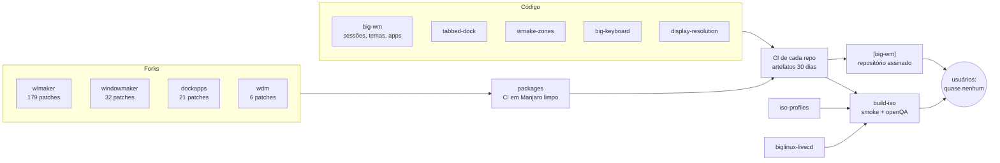
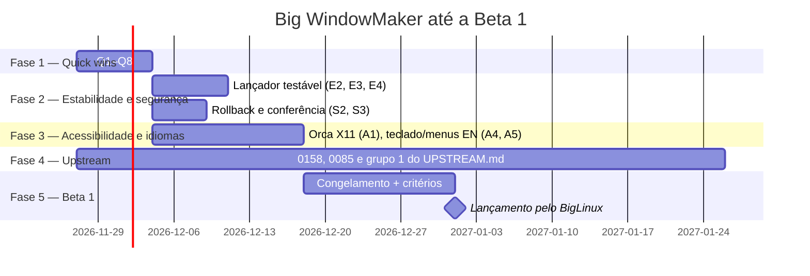

# Planejamento estratégico do Big WindowMaker

**Auditoria de 2026-11-26.** Este documento é o índice central do planejamento.
Ele não substitui os anteriores, aponta para eles:

| Documento | Papel |
| --- | --- |
| [PLANO.md](PLANO.md) | Plano da plataforma (repositório assinado, retorno dos usuários, upstream), com o estado de cada frente. Continua valendo. |
| [adr/0001-arquitetura.md](adr/0001-arquitetura.md) | Decisões de arquitetura (D1–D6), revistas em 2026-11-26. |
| [analise/](analise/) | Análises técnicas de outubro (Wayland, X11, empacotamento, ISO e CI). |
| [AUDITORIA.md](AUDITORIA.md) | Correções de outubro. **Desatualizado** em pontos (fala em LightDM; a sessão usa wdm desde 14/11). |

Convenção de evidência: **[F]** fato medido ou lido no código, com a
referência; **[H]** hipótese ainda não verificada; **[O]** opinião do auditor.

---

## 1. Resumo executivo

O Big WindowMaker tem **um mês de vida** (primeiro commit do big-wm em
2026-10-25) e já é tecnicamente sério: duas sessões (Window Maker no X11,
wlmaker no Wayland), repositório pacman assinado, ISO testada a cada build por
openQA (instalação BIOS e UEFI, sessões e atualização) e medições de memória em
VM e em hardware real. A engenharia está acima da média de projetos desse
tamanho.

O problema central não é técnico. **[F]** Em toda a história da organização
existem **0 issues**, cerca de **298 PRs** (todos de uma pessoa), **4 estrelas**
e as ISOs foram baixadas **de 1 a 13 vezes** cada uma, o que, pelas datas,
corresponde às próprias máquinas de teste. Foram **18 releases em 20 dias**.
O projeto otimiza um ciclo interno (corrigir → gerar ISO → testar) para um
público que ainda não existe.

**[O] A recomendação mais importante:** parar de tratar cada ISO como produto e
fazer **uma** versão Beta com critério de qualidade declarado, lançada por um
canal que já tem usuários (o BigLinux), e só então voltar a polir. Ao mesmo
tempo, reduzir o custo de manter os forks (179 patches no wlmaker) e corrigir
as lacunas de acessibilidade, que hoje são a área mais fraca.

---

## 2. Objetivos do projeto

1. Um desktop completo e integrado com a estética NeXTSTEP/OPENSTEP, para uso
   diário, sobre a base BigLinux/BigCommunity (Manjaro/Arch).
2. Duas sessões com a mesma cara: Window Maker (X11, padrão) e wlmaker
   (Wayland, experimental).
3. Bom desempenho em hardware antigo (referência: OptiPlex 760, Intel Q45 Gen4,
   3,7 GiB de RAM).
4. Instalação e atualização confiáveis (ISO + repositório `[big-wm]`).

---

## 3. Metodologia

- Leitura de código e documentação dos 14 repositórios (clones novos em
  2026-11-26), com quatro auditorias paralelas: código do big-wm; UX,
  acessibilidade e i18n; empacotamento e cadeia de fornecimento; pesquisa de
  projetos semelhantes.
- Métricas do GitHub: issues, PRs, estrelas, downloads de releases, resultado
  dos runs de CI nos últimos 14 dias.
- **Testes reais da ISO r71** (seção 9): instalação pelo Calamares numa VM nova
  e no OptiPlex 760 (SSD apagado), com medição antes/depois (aquecimento + 3
  boots por sessão, 21 verificações de funcionamento por boot).
- Comparação com Window Maker Live, helloSystem, Gershwin, NsCDE e o upstream
  do wlmaker (fontes na seção 11).

Limitações estão na seção 17.

---

## 4. Estado atual

**[F] Números (2026-11-26):**

| Item | Valor |
| --- | --- |
| Idade | big-wm desde 2026-10-25; 534 commits (370 desde 1/11) |
| Código próprio no big-wm | Python 22 mil linhas, C 17,5 mil, shell 11 mil |
| Testes do big-wm | `tests/run.sh` 3 804 linhas, 553 verificações; testes C (notificações, bloqueio); integração X11/Wayland em contêiner com os pacotes reais |
| ISO | openQA: instalação BIOS/UEFI, sessões, atualização pelo `[big-wm]`, saúde e segurança |
| CI do big-wm, 14 dias | 140 sucessos, 42 falhas (34 em PRs, **8 no `main`**) |
| Forks | wlmaker 179 patches; windowmaker 32; dockapps 21; wdm 6; 5 PRs abertos no upstream do wlmaker |
| Usuários | 0 issues; 4 estrelas; ISOs com 1–13 downloads |
| Documentação do big-wm | 345 arquivos em `docs/` (188 imagens, 46 relatórios datados, ~15 documentos de usuário) |

---

## 5. Pontos fortes

1. **[F] Testes de verdade, em camadas.** Estáticos, unidade em C, integração
   em contêiner, smoke test em QEMU e instalação openQA. Em 2026-11-26 o teste
   `bigwm_update` achou dois erros de pipeline antes da publicação
   (build-iso#22, #23).
2. **[F] Cadeia de fornecimento cuidada para o tamanho:** actions fixadas por
   SHA, sem `pull_request_target`, contêineres por digest, assinatura num
   contêiner sem rede, chave primária offline com subchave na CI, verificação
   num Manjaro limpo que recusa pacote adulterado.
3. **[F] Medição de desempenho reproduzível** (`tests/perf/`), em VM e em
   hardware real, com antes/depois.
4. **[F] Bloqueio de tela com cuidado de segurança:** senha em memória
   travada (`mlock`) e apagada (`explicit_bzero`), módulo de autenticação
   executado sem shell, saída segura quando a janela some.
5. **[O] Wayland pelo wlmaker é um diferencial real:** os projetos parecidos
   (Window Maker Live, NsCDE, Gershwin) são só X11, e GNOME 50 e Plasma 6.8 já
   abandonaram o X11.
6. **[F] Cultura de causa raiz:** cada correção vem com diagnóstico e
   laboratório (ver o histórico de PRs).

---

## 6. Pontos fracos e problemas identificados

### 6.1 Produto e comunidade
| ID | Problema | Evidência |
| --- | --- | --- |
| C1 | Sem usuários e sem canal de distribuição | 0 issues, 4 estrelas, ISOs com 1–13 downloads |
| C2 | Fator ônibus = 1 | todos os ~298 PRs são do mesmo autor; PRs aprovados pelo próprio autor |
| C3 | Cadência de release sem público | 18 pre-releases em 20 dias; r70 e r71 no mesmo dia com o **mesmo nome de arquivo** |
| C4 | Sem critério de qualidade para sair da Alpha | nenhum documento define "Beta" ou "estável" |

### 6.2 Acessibilidade e idiomas (a área mais fraca)
| ID | Problema | Evidência |
| --- | --- | --- |
| A1 | Orca instalado, mas a sessão não o liga | nada de `orca`/`at-spi`/`GTK_MODULES` em `big-wm/session` e `data`; PLANO.md "validar o Orca" pendente |
| A2 | Sem tema de alto contraste e sem texto grande | fontes fixas `pixelsize=12` em `data/GNUstep/Defaults/WindowMaker` |
| A3 | Dock e Clip não alcançáveis pelo teclado | README do big-wm, seção de atalhos |
| A4 | big-keyboard com texto fixo em português | `src/ui/bk-osk.c:1422`, sem `po/` nem `_()` |
| A5 | Menus só em inglês e português; espanhol 25% | `data/GNUstep/Defaults/WMRootMenu{,.pt_BR}`; `po/es.po` 110/435 |
| A6 | Wayland sem métodos de entrada (IBus/Fcitx) | README do big-wm, tabela X11 × Wayland |
| A7 | Orca no Wayland depende de `org.freedesktop.a11y.KeyboardMonitor`, que o wlmaker não implementa [H] | pesquisa (seção 11) |

### 6.3 UX
| ID | Problema | Evidência |
| --- | --- | --- |
| U1 | Boas-vindas contradiz o sistema | `welcome/bigwmwelcome/ui.py:648-672` diz que o teclado na tela é só X11 e oferece o Onboard (o big-keyboard funciona no Wayland); `ui.py:642` oferece o localizar ponteiro no Wayland, onde ele não existe |
| U2 | 38 itens do Window Maker ausentes no Wayland | `big-wm/docs/wayland-parity.md` |
| U3 | Tema escuro inconsistente | GTK4 puro e Qt só trocam ao reabrir; libadwaita fica Adwaita no X11 (`docs/tema-claro-escuro.md`) |
| U4 | Mensagens de erro vagas | `big-wm-screenshot:145`, `big-wm-compositor:59,76` |
| U5 | Boas-vindas nunca aparece na live | quem experimenta a ISO não vê o tour |

### 6.4 Arquitetura, estabilidade e código
| ID | Problema | Evidência |
| --- | --- | --- |
| E1 | Custo dos forks | 179 patches no wlmaker; cada rebase custa uma rodada |
| E2 | `startbigwm`/`startbigwm-wayland` nunca executados por um teste | `tests/integration/x11.sh` repete os passos à mão |
| E3 | Lançadores sem timeout | `firstrun` (1 693 linhas) e `wprefs-sync` síncronos; um travamento atrasa a sessão indefinidamente |
| E4 | ~~No Wayland, um programa do Autostart que não inicia encerra a sessão~~ (não procede, ver 12b) | `data/wlmaker/Config.plist.in:240-245` |
| E5 | `main` quebrado 8 vezes em 14 dias | runs de push com falha no big-wm |
| E6 | `big-wm-wprefs-sync` (2 196 linhas) existe só para traduzir a configuração do X11 para o wlmaker | camada de tradução frágil por natureza |
| E7 | `eval` de linhas de configuração | `big-wm-dockapps:276,279,284` |
| E8 | Primeiro boot da live sem rede, 2 vezes no OptiPlex | rodada r57 e 2026-11-26; sem log (journal volátil) |
| E9 | `grub-reboot` não é "uma vez só" em btrfs | o GRUB não grava o `grubenv` em btrfs; a máquina voltou à live |

### 6.5 Segurança e cadeia de fornecimento
| ID | Problema | Evidência |
| --- | --- | --- |
| S1 | Segredo de assinatura sem *environment* | `repo/.github/workflows/publicar.yml`, job `publicar` |
| S2 | Rollback impossível no `[big-wm]` | `build-repo.sh`: a maior versão sempre ganha |
| S3 | O repositório confere 17 pacotes; a ISO, 57 | `EXPECTED_PACKAGES` |
| S4 | Três fontes por `http` simples | `big-dockapps/PKGBUILD:149,175`, `onestepback-gtk-theme/PKGBUILD:26` |
| S5 | Fontes sem checksum | `wmake-zones` (`#tag`), `libxfce4ui`, `thunar-git` (`SKIP`) |
| S6 | ISO sem assinatura, sem SBOM, sem atestado de proveniência | build-iso README, "Fase 2" |
| S7 | Build não reproduzível | `big-wm/Makefile:128` grava a data; `ci/build-package.sh:33` faz `pacman -Syu` |
| S8 | Hospedagem só no GitHub | releases `x86_64` e ISOs; sem espelho |
| S9 | `pkexec` sem política própria | `big-wm-airplay-setup` usa a regra padrão de admin |
| S10 | Contêiner `--privileged` sem Dockerfile público | `xivastudio/biglinux_build_package` (build-iso README, "Limites") |

### 6.6 Diagnóstico
| ID | Problema | Evidência |
| --- | --- | --- |
| D1 | Coredump registrado, mas sem o core (era do teste, ver 12b) | OptiPlex r71: `gnome-calculator` SIGSEGV, "Resource limits disable core dumping"; a sessão real tem limite ilimitado → [H] limite herdado do coletor do teste |
| D2 | Antes da r71 a verificação "nenhum coredump" passava sem testar nada | coredumps desligados (`Storage=none`) até a r71 |

---

## 7. Pontos cegos

| Perfil | O que sentiria falta |
| --- | --- |
| Usuário iniciante | Não sabe que o projeto existe. Se baixar, recebe 3 partes de 7z para juntar e uma ISO "Alpha" com aviso de "não use em produção". |
| Usuário avançado | Changelog por versão (só agora a 1.0.0), rollback de pacote, como reportar além do botão. |
| Pessoa cega ou com baixa visão | Orca não liga na sessão; sem alto contraste; fonte fixa. **Hoje o sistema não é utilizável por ela.** |
| Usuário que não lê português | big-keyboard em português; menus em inglês; documentação quase toda em português. |
| Hardware limitado | Bem atendido no X11 (medido). O Wayland em GPU antiga usa pixman. |
| Desenvolvedor novo | 345 arquivos em `docs/`, a maioria diários; `tests/run.sh` com 3 804 linhas; sem guia "primeiro PR em 30 minutos". |
| Mantenedor | 179 patches para rebasear; nenhuma segunda pessoa com acesso ou conhecimento. |
| Especialista em segurança | Ver 6.5. Nenhuma revisão externa do código de bloqueio (~5 mil linhas de C no caminho da senha). |
| Designer | Ícones e capturas são fortes; a experiência ainda é "um desktop de entusiasta", com tema escuro incompleto. |

**[O] Para onde o projeto não está olhando:**
1. **Para quem vai usar.** Todo o esforço vai para o produto e quase nada para
   o caminho até a primeira pessoa de fora.
2. **Para a sustentabilidade dos forks.** Cada funcionalidade nova no wlmaker
   vira patch local; a dívida cresce mais rápido que o envio ao upstream (5 de
   179).
3. **Para a definição de pronto.** Sem critério de Beta, toda ISO é "mais uma".
4. **Para a acessibilidade**, que no ritmo atual nunca chega à frente da fila.

---

## 8. Opinião profissional

1. **Estratégia:** congelar funcionalidades por 4 semanas, declarar os
   critérios de Beta (seção 13) e lançar **uma** Beta como edição comunitária
   do BigLinux, com o anúncio no fórum, no Telegram e na nota de release do
   BigLinux no DistroWatch. Uma entrada própria no DistroWatch leva anos.
2. **Imediatamente:** os *quick wins* da seção 12 (dois dias de trabalho).
3. **Faria diferente:** menos releases e mais usuários; cada ISO com número de
   versão (Beta 1, Beta 2), não `rNN`; uma ISO por semana no máximo.
4. **Manteria:** o openQA, a medição de desempenho, o repositório assinado, a
   cultura de causa raiz e o foco em hardware antigo.
5. **Removeria:** os diários de missão e relatórios datados de `big-wm/docs`
   (para um arquivo ou wiki); `tests/perf/resultados` do repositório (8,7 MB).
6. **Reconstruiria:** o `startbigwm`/`startbigwm-wayland` como um único
   lançador testável, com timeout por etapa e log; e o `wprefs-sync`, como
   configuração comum gerada para as duas sessões em vez de tradução contínua.
7. **Tecnologia:** manter o wlmaker, mas investir nele **pelo upstream**:
   cada patch genérico vira PR antes de virar funcionalidade local.
8. **Funcionalidades:** só as que destravam pessoas: Orca ligado e
   alto contraste; teclado e menus em inglês e espanhol; instalação de uma ISO
   única (sem 7z, por um espelho).
9. **Questionaria:** a manutenção de três backends de bloqueio (xsecurelock,
   gtklock, i3lock); a quantidade de processos na sessão Wayland (~14 mais os
   dockapps).
10. **Investiria mais em:** acessibilidade, upstream e comunidade.
11. **Tempo desnecessário hoje:** README e capturas a cada ISO; ISOs de
    "correção do dia" sem público.
12. **Visão:** em 6 meses, edição comunitária oficial do BigLinux, 50 usuários
    ativos, 10 issues de pessoas de fora, metade dos patches do wlmaker no
    upstream. Em 1 ano, Wayland como sessão padrão em hardware com GPU
    moderna, um segundo mantenedor. Em 3 anos, referência de desktop
    "clássico" no Wayland, com o wlmaker maduro no upstream e o Big WindowMaker
    como a distribuição que o leva a usuários comuns.
13. **Inovação transformadora:** ser o primeiro desktop clássico acessível no
    Wayland: implementar no wlmaker (upstream) o `KeyboardMonitor` para o Orca.
    Nenhum projeto parecido tem isso.
14. **Cinco melhorias:** (1) Beta com critério e canal BigLinux; (2) Orca e
    alto contraste; (3) metade dos patches do wlmaker no upstream; (4) um
    lançador de sessão testado e com timeout; (5) segundo mantenedor com
    revisão obrigatória no bloqueio e no instalador.
15. **Recomendação mais importante:** o próximo marco não é uma ISO, é a
    **primeira pessoa de fora usando o sistema e abrindo uma issue**.

---

## 9. Validação real da ISO r71 (2026-11-26)

ISO `big-windowmaker_TESTING_2026-11-26_k618-r71` (SHA-256 `07ab573c…`),
instalada do zero pelo Calamares. Medição: aquecimento + 3 boots medidos por
sessão, amostras 30/90/300 s depois do login, 21 verificações de funcionamento
por boot (ferramentas `big-wm/tests/perf`).

**VM** (QEMU/KVM, 4 vCPU, 4 GiB, virtio): antes = instalação pura da r65;
depois = instalação nova da r71, mesmo hardware virtual.

| Sessão | Métrica (MiB, 300 s) | Antes (r65) | Depois (r71) | Δ |
| --- | --- | --- | --- | --- |
| X11 | memória usada | 953,2 | 946,7 | −6,5 |
| X11 | processos da sessão | 304,3 | 295,1 | −9,2 |
| X11 | tempo até a sessão pronta | 2,9 s | 2,9 s | 0 |
| Wayland | memória usada | 961,1 | 953,1 | −8,0 |
| Wayland | processos da sessão | 339,5 | 339,6 | +0,1 |
| Wayland | tempo até a sessão pronta | 3,3 s | 3,5 s | +0,2 |
| Ambas | verificações de funcionamento | 21/21 em 8/8 boots | 21/21 em 8/8 boots | — |

**[F]** Diferenças no nível do ruído. Na r71: `pacman -Qm` = **0** pacotes
estrangeiros (eram 69 antes do repositório), "Relatar problema" nos dois
menus, coredumps ligados, firewall ativo, `[big-wm]` primeiro e chave no
chaveiro.

**OptiPlex 760** (Intel Q45 Gen4, 3,7 GiB, SSD 120 GB): antes = instalação da
época da r62 com atualizações manuais (sem `[big-wm]`, com `IgnorePkg`);
depois = SSD apagado e r71 instalada pelo Calamares.

| Sessão | Métrica (MiB, 300 s) | Antes | Depois (r71) | Δ |
| --- | --- | --- | --- | --- |
| X11 | memória usada | 1 013,6 | 1 008,3 | −5,3 |
| X11 | processos da sessão | 297,0 | 297,6 | +0,6 |
| X11 | tempo até a sessão pronta | 6,8 s | 6,8 s | 0 |
| Wayland | memória usada | 1 016,1 | 1 007,8 | −8,3 |
| Wayland | processos da sessão | 345,0 | 345,6 | +0,6 |
| Wayland | tempo até a sessão pronta | 7,5 s | 7,0 s | −0,5 |
| — | boot (`systemd-analyze`, 6 boots) | 17,8–19,8 s | 17,1–18,5 s | ≈ −1 s |
| — | verificações de funcionamento | 31/32 rodadas com 21/21 (1 falha: vigia de monitores no X11) | 31/32 com 21/21 (1 falha: coredump do `gnome-calculator` no aquecimento X11) | — |

**[F]** Mesmo patamar de memória, boot um pouco mais rápido. A falha do depois
só pôde aparecer porque a r71 liga os coredumps: no antes, a mesma
verificação passava sem testar nada (D2).

Achados da instalação real: E8 (live sem rede no primeiro boot), E9
(`grub-reboot` em btrfs), D1 (coredump sem core). Primeiro boot instalado:
32,6 s (com as tarefas de primeiro boot), nenhuma unidade com falha, nenhum
GPU hang, driver intel (SNA), unidades Gen4 e resolução do GRUB ligadas pelo
Calamares.

---

## 10. Maturidade (0 a 10)

| Categoria | Nota | Justificativa e evidência | Para chegar a 10 |
| --- | --- | --- | --- |
| Arquitetura | 7 | Monorepo do desktop + forks isolados + pipeline claro; X11/Wayland por ramos no mesmo script | Lançador único testável; config comum às duas sessões |
| Qualidade de código | 7 | 1 TODO no código, `-Werror` no bloqueio, shellcheck em tudo | Sem `eval` de config; scripts grandes divididos |
| Desempenho | 8 | Medido em VM e hardware real; r71 no nível da r65 | Orçamento de memória por sessão com alerta no CI |
| Estabilidade | 6 | 21/21 em quase todos os boots; `main` quebrado 8×/14 dias; achados E3, E4, E8 | Timeouts, `main` protegido por CI obrigatório |
| Segurança | 7 | Ver 5 e 6.5 | S1–S10 resolvidos; revisão externa do bloqueio |
| Privacidade | 8 | Relatório anonimizado, nada enviado sem ação do usuário | Política de privacidade escrita |
| UX/UI | 6 | Visual forte; U1–U5 | Paridade Wayland nos itens de uso diário; tema escuro completo |
| Acessibilidade | 3 | A1–A7 | Orca de ponta a ponta nas duas sessões; alto contraste; teclado em todo o desktop |
| Funcionalidades | 7 | Dock, Clip, zonas, teclado, monitores, relatório | Paridade Wayland; métodos de entrada |
| Compatibilidade | 5 | x86_64 BIOS/UEFI testado; Wayland parcial; só pt/en | i18n, IBus/Fcitx, aarch64 [O, longo prazo] |
| Escalabilidade (equipe) | 3 | Fator ônibus 1 | Dois mantenedores ativos |
| Documentação | 6 | Guia do usuário, READMEs fortes; `docs/` inflado | Docs de usuário traduzidos; diários arquivados |
| Testes | 7 | Camadas completas; lançadores e PAM real sem teste | E2; teste de bloqueio com PAM real em VM |
| Automação | 8 | CI, openQA, repositório e notas de versão automáticos | Assinatura da ISO, SBOM |
| Manutenibilidade | 4 | 179 + 32 + 21 patches; um mantenedor | Metade dos patches no upstream |
| Inovação | 7 | Wayland clássico, zonas, teclado com controle | `KeyboardMonitor` no wlmaker |
| Experiência geral | 6 | Boa para quem já conhece Window Maker | Primeira hora guiada, sem contradições |
| Preparação para produção | 4 | Alpha, sem canal, sem rollback | Critérios de Beta cumpridos (seção 13) |
| Sustentabilidade | 2 | Sem usuários, sem segundo mantenedor, forks crescendo | C1, C2, E1 |

---

## 11. Comparação com projetos semelhantes

| Projeto | O que faz melhor | O que fazemos melhor | Lição |
| --- | --- | --- | --- |
| [Window Maker Live](https://sourceforge.net/projects/wmlive/) (Debian) | Segue cada versão do Debian; amd64, arm64 e i386; imprensa frequente ([The Register](https://www.theregister.com/2025/12/09/microsoft_windows_maker_live_132/)); Ko-fi | Wayland; integração (Dock com Abas, zonas, teclado); testes automatizados | Atrelar-se ao ritmo de uma distribuição-mãe e falar com a imprensa |
| [helloSystem](https://distrowatch.com/hellosystem) (FreeBSD) | Visão e repercussão | Atividade contínua | "Dormant" desde 2023: um mantenedor visionário não basta |
| [Gershwin](https://github.com/gershwin-desktop/gershwin-desktop) (GNUstep) | ~525 estrelas; ISOs para várias bases; vitrine no GhostBSD; imprensa | Wayland; maturidade de uso diário | Hospedeiro + apresentação na comunidade GNUstep |
| [NsCDE](https://github.com/NsCDE/NsCDE) | Pacote no openSUSE | Atividade | Última versão em 2023; só X11 |
| [wlmaker](https://github.com/phkaeser/wlmaker) (upstream) | Empacotado em Debian, Fedora, Ubuntu, openSUSE, FreeBSD | Integração de desktop; dezenas de correções | O roadmap não fala de acessibilidade: oportunidade de contribuição |

Fonte das tendências: GNOME 50 e KDE Plasma 6.8 sem sessão X11
([9to5linux](https://9to5linux.com/kde-plasma-6-8-desktop-environment-to-drop-the-x11-session-and-go-wayland-only)).
Window Maker upstream: última versão 0.96.0 (2023), patches só por e-mail
(`wmaker-dev@googlegroups.com`).

---

## 12. Quick wins (≤ 1 dia cada) — Etapa 1

| ID | Tarefa | Estado (2026-11-27) |
| --- | --- | --- |
| Q1 | Corrigir as contradições do app de boas-vindas (U1) | ✅ big-wm#75: teclado na tela = big-keyboard nas duas sessões. O "localizar ponteiro" já funcionava no Wayland; o README é que estava errado. |
| Q2 | Proteger o segredo `REPO_SIGNING_KEY` com um *environment* (S1) | 🟡 repo#1: ambiente `repo-assinatura` (só `main`) em uso. Falta o mantenedor regravar o segredo no ambiente a partir da mídia offline (o GitHub não deixa mover um segredo). |
| Q3 | Trocar as 3 fontes `http` (S4) | ✅ packages#62: espelho `fontes-externas`, mesmos sha256 |
| Q4 | `timeout` nas etapas da abertura da sessão (E3) | ✅ big-wm#76: `big_wm_step`; laboratório com firstrun travado: encerrado em 120 s, sessão abriu |
| Q5 | Nome de arquivo da ISO com o `rNN` (C3) | ✅ build-iso#26 (vale na próxima publicação) |
| Q6 | Atalho para ligar o Orca (A1) | ✅ big-wm#77: Super+Alt+S nas duas sessões, validado em VM (X11 e Wayland) |
| Q7 | Organizar `big-wm/docs` | ✅ big-wm#78: índice `docs/README.md` (usuários, técnico, arquivo), sem mover arquivos |
| Q8 | CI obrigatório no `main` (E5) | ✅ big-wm, tabbed-dock, big-keyboard, display-resolution, wmake-zones. Falta o packages (precisa de um job de resumo, Etapa 2). |

Achado durante a Etapa 1: teste instável do microfone da bandeja
(`test_single_instance_and_sigterm`, espera de 5 s pelo `pactl`) quebrou um
CI de PR. Entra na Etapa 2 com E5.

## 12b. Etapa 2 — estabilidade e segurança (2026-11-27)

| Tarefa | Estado | O que se verificou |
| --- | --- | --- |
| T05 Lançadores em teste | ✅ big-wm#82 (X11), #83 (Wayland) | A integração abre as sessões pelo `startbigwm` e pelo `startbigwm-wayland` reais (163 e 164 verificações passando, XWayland sob demanda incluído). |
| T06 Autostart do wlmaker | ✅ big-wm#79 (só comentário) | **E4 não existia:** o wlmaker só encerra com linha malformada ou sem `pipe`/`fork`. Na VM, um comando inexistente no Autostart só registrou o erro no `wlmaker.log` e a sessão seguiu. |
| T07 Rollback | ✅ repo#2 (documentação) | Reverter na origem gera versão maior; versão errada maior do que devia: apagar o anexo e republicar. O segundo caso não foi exercitado no repositório real. |
| T08 Lista única de pacotes esperados | ⚫ não feito | O release é a fonte da verdade: um pacote publicado não some. A lista do repositório só protege a primeira publicação; unificar com a da ISO acoplaria dois repositórios por pouco ganho. |
| T15 Coredump sem core | ✅ big-wm#81 | **D1 era do teste:** o `sudo` zera o limite de core dos comandos. Na sessão real o limite é ilimitado. O script de teste agora libera o limite (VM: `COREFILE present`). |
| Q8 `packages` protegido | ✅ packages#63 | Job `Resultado` com nome fixo, exigido no `main`. |
| Teste instável do microfone | 🟡 big-wm#80 | Não reproduz (0 de 40 com a CPU carregada); a falha agora mostra o estado do processo. |

## 13. Etapas: estado e critérios

Legenda: ✅ concluída e validada · 🟢 implementada, falta validar ·
🟡 parcial · 🔵 em andamento · ⚪ não iniciada · 🔴 crítica ou bloqueada ·
🟣 nova recomendação · ⚫ obsoleta.

| Etapa | Estado | Evidência ou observação |
| --- | --- | --- |
| Repositório `[big-wm]` assinado | ✅ | verificação no Manjaro limpo; openQA `bigwm_update`; VM e OptiPlex r71 |
| Versão semântica no big-wm | ✅ | `1:1.0.0.r…` no repositório |
| Relatar problema | ✅ | VM r71: menus e relatório |
| Coredumps na edição | 🟡 | ligados; core não gravado no teste (D1) |
| Guia do usuário | 🟢 | existe; ninguém de fora leu |
| Upstream do wlmaker | 🔵 | 5 de 179 enviados |
| Patch 0032 do Window Maker | 🔴 | pronto; depende de envio por e-mail do mantenedor |
| Revisão humana | 🔴 | nenhum revisor |
| Orca de ponta a ponta | ⚪ | PLANO.md |
| Licença do iso-profiles | 🔴 | decisão: o fork fica só aqui; arquivos herdados sem licença |
| Critérios de Beta | 🟡 | **Beta 1 publicada em 27/11/2026 por decisão do mantenedor** (ISO r74, openQA verde em BIOS e UEFI); abertos: openQA 7 dias seguidos; Orca lendo os menus do Window Maker (o atalho Super+Alt+S e os aplicativos já funcionam); menus em inglês (o big-keyboard já tem); ISO num espelho fora do GitHub com `SHA256SUMS` assinado; 5 pessoas de fora |
| AUDITORIA.md | ⚫ | desatualizado; substituído por este documento e pelo PLANO.md |

**Critérios propostos para a Beta 1** (todos verificáveis):

- [ ] openQA verde em BIOS e UEFI por 7 dias seguidos, sem rerun.
- [ ] Nenhum P0/P1 aberto.
- [ ] Orca liga por atalho e lê menus e o terminal no X11.
- [ ] big-keyboard e menus em inglês.
- [ ] Boas-vindas sem contradições (Q1).
- [ ] Lançadores com timeout e teste (E2, E3).
- [ ] ISO numa só peça num espelho além do GitHub, com `SHA256SUMS` assinado.
- [ ] Rollback documentado e testado (S2).
- [ ] 5 pessoas de fora instalaram e responderam um questionário.

---

## 14. Matriz de prioridades

| Prioridade | Itens |
| --- | --- |
| P0 | — (nenhuma perda de dados ou falha de segurança ativa encontrada) |
| P1 | C1, C2, A1, E3, E4, S1, S2 |
| P2 | E1, E2, E5, E6, S3, S5, S6, S7, A2, A4, D1 |
| P3 | U1–U5, A3, A5, A6, E7, E8, E9, S4, S8, S9 |
| P4 | Q7, docs em inglês, alto contraste no Qt |
| P5 | A7 (`KeyboardMonitor` no wlmaker), aarch64, configuração comum às sessões (E6) |

---

## 15. Roadmap

### Tarefas

Formato curto por tarefa; os detalhes de implementação ficam no PR de cada
uma, como hoje.

| ID | Título | Fase | Prioridade | Esforço | Depende de | Critério de aceitação |
| --- | --- | --- | --- | --- | --- | --- |
| T01 | Boas-vindas sem contradições | 1 | P3 | 0,5 d | — | textos conferem com a tabela X11 × Wayland; teste em `tests/` |
| T02 | Environment para `REPO_SIGNING_KEY` | 1 | P1 | 0,5 h | — | `publicar` só roda com o environment; run verde |
| T03 | Fontes `https` | 1 | P3 | 0,5 d | — | `grep http://` nos PKGBUILDs vazio; CI do packages verde |
| T04 | Timeouts nos lançadores | 2 | P1 | 1 d | — | `firstrun` travado (laboratório) não impede a sessão; log da etapa |
| T05 | `startbigwm` executado em teste | 2 | P2 | 2 d | T04 | integração roda o lançador real nas duas sessões |
| T06 | Autostart do wlmaker sem derrubar a sessão | 2 | P1 | 1 d | — | programa inexistente no Autostart: sessão continua, erro no log |
| T07 | Rollback no `[big-wm]` | 2 | P1 | 2 d | — | `ROLLBACK=nome=versão` publica a versão anterior com epoch/pkgrel novo; verificação no Manjaro limpo |
| T08 | `EXPECTED_PACKAGES` único (ISO e repo) | 2 | P2 | 0,5 d | — | um arquivo lido pelos dois workflows |
| T09 | Orca por atalho no X11 | 3 | P1 | 3 d | — | Orca lê menu raiz, terminal e Thunar (teste manual gravado) |
| T10 | i18n do big-keyboard | 3 | P2 | 2 d | — | `po/` com en e pt_BR; interface em inglês com `LANG=en_US.UTF-8` |
| T11 | Menus por gettext (en, pt_BR, es) | 3 | P3 | 3 d | — | menu gerado na instalação; `tests/i18n` |
| T12 | Alto contraste e texto grande | 3 | P2 | 3 d | — | tema WM + GTK; fonte configurável |
| T13 | Patches 0158 e 0085 ao upstream | 4 | P2 | 2 d | — | PRs abertos no phkaeser/wlmaker |
| T14 | Grupo 1 do `UPSTREAM.md` | 4 | P2 | contínuo | T13 | metade dos patches fora do `packages` em 3 meses |
| T15 | Coredump com core no teste e no relatório | 2 | P2 | 1 d | — | crash de teste gera core; `big-wm-doctor --report` mostra o backtrace resumido |
| T16 | Live sem rede no 1º boot | 2 | P3 | 2 d | — | causa achada (journal persistente na live via kernel cmdline) ou descartada |
| T17 | `SHA256SUMS.sig` e atestado de proveniência | 5 | P2 | 1 d | — | `gpg --verify SHA256SUMS.sig`; `gh attestation verify` |
| T18 | ISO numa peça em espelho | 5 | P2 | 2 d | — | download sem 7z; SHA conferido |
| T19 | Critérios da Beta 1 cumpridos | 5 | P1 | — | T01–T18 | checklist da seção 13 |
| T20 | Lançamento pelo BigLinux | 5 | P1 | — | T19 | anúncio no fórum e no Telegram do BigLinux |
| T21 | Segundo mantenedor | contínua | P1 | — | — | uma pessoa com revisão em PRs de bloqueio, PAM, instalador e pacman.conf |

Estratégia de rollback geral: cada tarefa é um PR revertível; mudanças de
pacote passam pelo `[big-wm]`, que com T07 aceita voltar uma versão.

---

## 16. Métricas de sucesso

| Métrica | Hoje | Meta 3 meses | Meta 6 meses |
| --- | --- | --- | --- |
| Downloads da ISO por versão | 1–13 | 100 | 500 |
| Issues de pessoas de fora | 0 | 10 | 40 |
| Mantenedores ativos | 1 | 1 + 1 revisor | 2 |
| Patches no wlmaker | 179 | 120 | 90 |
| openQA verde sem rerun | — | 7 dias seguidos | 30 dias |
| `main` quebrado (14 dias) | 8 | 0 | 0 |
| Nota de acessibilidade | 3 | 6 | 8 |

---

## 17. Limitações desta auditoria

- DistroWatch e Reddit não responderam à pesquisa; números do DistroWatch vêm
  de páginas em cache.
- Não houve teste com pessoas reais (usabilidade) nem com leitor de tela.
- Não houve revisão linha a linha do C do bloqueio; só os padrões de risco.
- Hardware real: só o OptiPlex 760 (Intel Gen4). Sem AMD, NVIDIA, notebook ou
  HiDPI.
- O "Relatar problema" nunca recebeu um relato real; o caminho até a issue não
  foi exercitado por um usuário.

## 18. Próximos passos

1. O mantenedor avalia este plano e escolhe o que aprovar.
2. Fase 1 (quick wins) em PRs pequenos.
3. Revisão deste documento depois da Beta 1, com a mesma metodologia.
