<p align="center">
  
</p>

<h1 align="center">Big WindowMaker</h1>

<p align="center">
  <b>O Window Maker como desktop completo, sobre o <a href="https://www.biglinux.com.br">BigLinux</a> / <a href="https://communitybig.org">BigCommunity</a>.</b><br>
  A elegância do NeXTSTEP, a integração de um sistema atual e duas sessões:<br>
  <b>X11</b> (Window Maker) e <b>Wayland</b> (wlmaker).
</p>

<p align="center">
  <a href="https://github.com/big-windowmaker/build-iso/releases"></a>
  
  
  
</p>

<p align="center">
  <a href="#-baixar-a-iso">Baixar</a> ·
  <a href="#-gravar-no-pendrive">Gravar</a> ·
  <a href="#-iniciar-pelo-pendrive">Iniciar</a> ·
  <a href="#-instalar">Instalar</a> ·
  <a href="#-primeiros-passos">Primeiros passos</a> ·
  <a href="#-testar-numa-máquina-virtual">Máquina virtual</a> ·
  <a href="#-problemas-comuns">Problemas comuns</a> ·
  <a href="#-repositórios">Repositórios</a> ·
  <a href="#-contribuir">Contribuir</a> ·
  <a href="#créditos-e-licença">Créditos</a> ·
  <a href="#in-english">English</a>
</p>

<p align="center">
  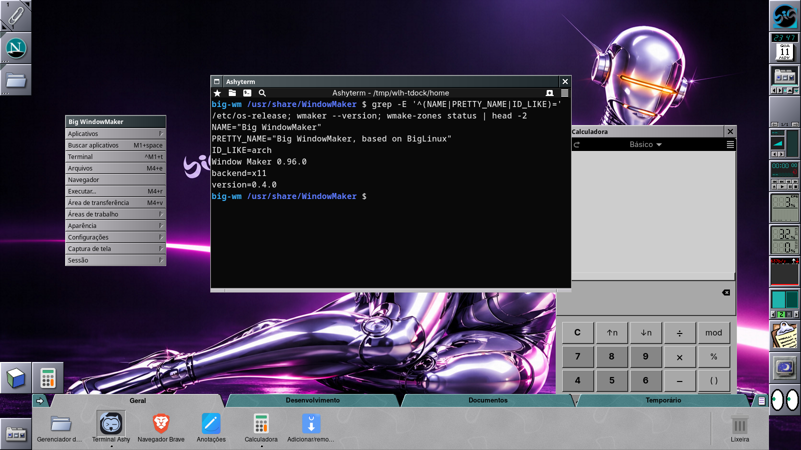
</p>

> [!WARNING]
> **Versão Alpha (pre-release).** É uma ISO de teste: os pacotes do Big
> WindowMaker vêm de um repositório local **não assinado** e ainda não recebem
> atualizações pelo `pacman`. Experimente primeiro no **modo live** ou numa
> **máquina virtual**, e não instale no computador de trabalho sem backup.

## ✨ Destaques

| | |
|---|---|
| **Duas sessões, a mesma cara** | Window Maker no X11 (padrão, estável) e wlmaker no Wayland (experimental), com o mesmo tema, menus, papel de parede e atalhos. Você escolhe na tela de login. |
| **Dock, Clip e dockapps** | Dock com relógio, bandeja, volume, CPU, memória e rede; Clip com navegador e arquivos; cerca de 30 dockapps clássicos (wmcube, wmglobe, wmweather, wmmoonclock...) prontos no menu *Aparência > Dockapps*. |
| **Zonas e mosaico** | [wmake-zones](https://github.com/big-windowmaker/wmake-zones): zonas de encaixe ao arrastar e mosaico automático, também em vários monitores. Vem desligado; liga em *Aparência > Organização de janelas*. |
| **Claro ou escuro** | *Aparência > Tema claro / Tema escuro* muda janelas, menus, Dock, GTK 2/3/4, libadwaita e Qt de uma vez. |
| **Tudo no estilo NeXTSTEP** | Barras de título do Window Maker em GTK, Qt, Firefox e VSCodium; ícones redesenhados; GRUB e Plymouth no estilo da tela do Window Maker. |
| **Área de transferência** | **Super+V** abre o histórico, com busca, favoritos e privacidade, nas duas sessões. |
| **Dock com Abas** | Uma prateleira horizontal com abas, inspirada no OPENSTEP 4.0 beta, com os aplicativos abertos e os favoritos; controlada pelo ladrilho do Dock ([tabbed-dock](https://github.com/big-windowmaker/tabbed-dock)). |
| **Monitores** | *Configurações > Monitores*: resolução, disposição, perfis por conjunto de monitores e volta automática em 15 s se algo der errado ([big-wm-display-resolution](https://github.com/big-windowmaker/big-wm-display-resolution)). |
| **Leve** | A sessão X11 de referência usa cerca de 250 MiB de memória (PSS) cinco minutos depois do login. |

<table>
<tr>
<td width="50%">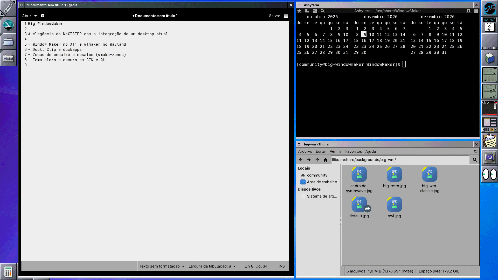<br><b>Mosaico automático</b> com o wmake-zones (X11)</td>
<td width="50%">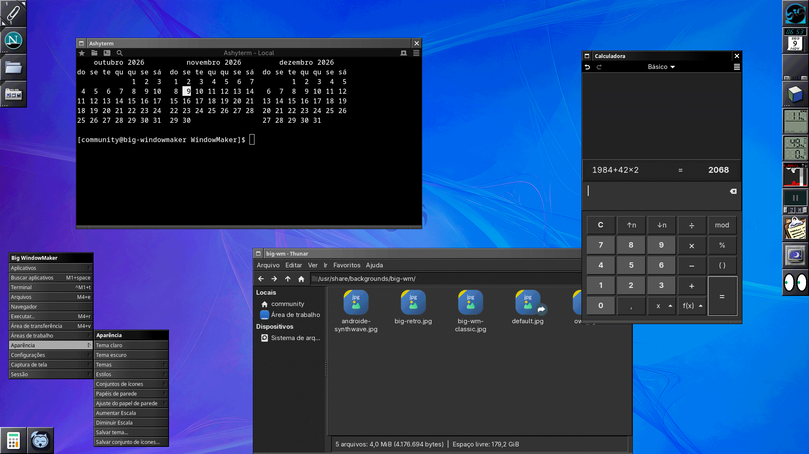<br><b>Tema escuro</b> em todos os toolkits (X11)</td>
</tr>
<tr>
<td>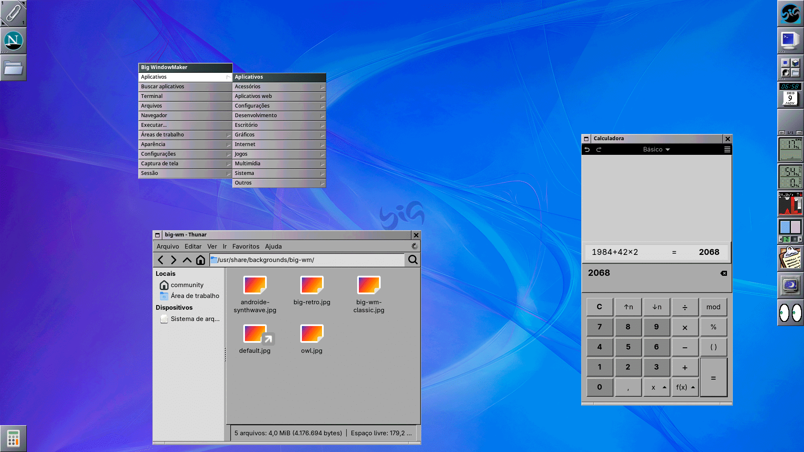<br><b>Sessão Wayland</b> com o wlmaker</td>
<td>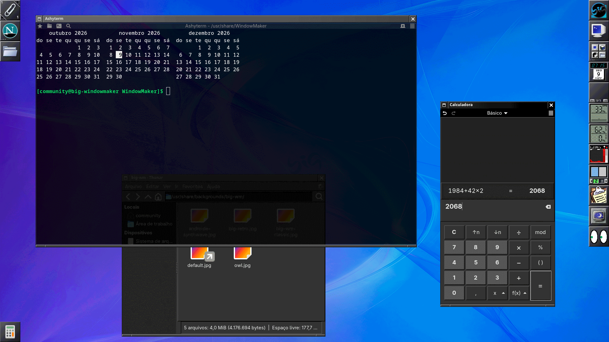<br><b>Wayland no tema escuro</b></td>
</tr>
<tr>
<td>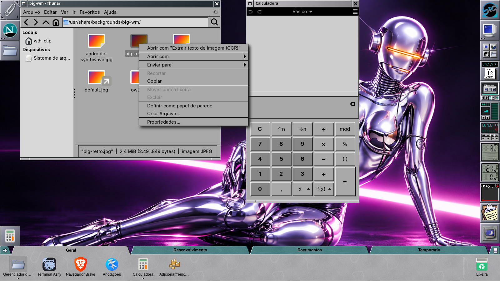<br><b>Menus no lugar</b> no Wayland e no XWayland (12/11)</td>
<td>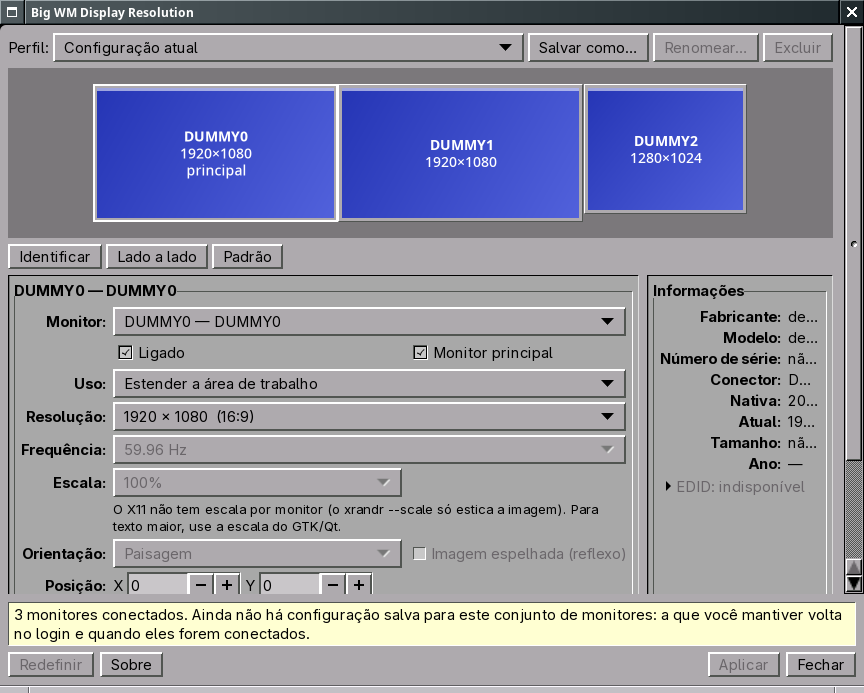 Monitores com três monitores desenhados em escala, resolução, frequência, orientação e informações do EDID"><br><b>Monitores</b>: três telas, perfis e reversão segura (12/11)</td>
</tr>
</table>

## 💻 Requisitos

| | Mínimo | Recomendado |
|---|---|---|
| Processador | x86_64 (64 bits) | 2 núcleos ou mais |
| Memória | 2 GiB | 4 GiB ou mais |
| Disco | 20 GB (o sistema recém-instalado ocupa cerca de 5 GiB) | 40 GB ou mais |
| Firmware | UEFI ou BIOS (Legacy) | UEFI |
| Pendrive | 8 GB | 8 GB ou mais, USB 3 |

> [!NOTE]
> **Desligue o Secure Boot.** A ISO traz o GRUB sem o *shim* assinado, então
> um firmware com Secure Boot ativo recusa o boot.

## 📥 Baixar a ISO

**Versão atual:** Big WindowMaker **Alpha de novembro** (06/11/2026, kernel 6.18).

<p align="center">
  <a href="https://github.com/big-windowmaker/build-iso/releases/tag/big-windowmaker_TESTING_2026-11-06_k618-r35"></a>
</p>

A ISO tem 4,8 GiB e o GitHub limita cada arquivo a 2 GB, por isso ela vem em
**três partes `.7z`**. Baixe as três para a mesma pasta, junto com o
`SHA256SUMS`:

| Arquivo | Tamanho |
|---|---|
| [`big-windowmaker_TESTING_2026-11-06_k618.iso.7z.001`](https://github.com/big-windowmaker/build-iso/releases/download/big-windowmaker_TESTING_2026-11-06_k618-r35/big-windowmaker_TESTING_2026-11-06_k618.iso.7z.001) | 2,0 GB |
| [`big-windowmaker_TESTING_2026-11-06_k618.iso.7z.002`](https://github.com/big-windowmaker/build-iso/releases/download/big-windowmaker_TESTING_2026-11-06_k618-r35/big-windowmaker_TESTING_2026-11-06_k618.iso.7z.002) | 2,0 GB |
| [`big-windowmaker_TESTING_2026-11-06_k618.iso.7z.003`](https://github.com/big-windowmaker/build-iso/releases/download/big-windowmaker_TESTING_2026-11-06_k618-r35/big-windowmaker_TESTING_2026-11-06_k618.iso.7z.003) | 0,9 GB |
| [`SHA256SUMS`](https://github.com/big-windowmaker/build-iso/releases/download/big-windowmaker_TESTING_2026-11-06_k618-r35/SHA256SUMS) | somas de verificação |

> [!TIP]
> As ISOs saem como *pre-release*, e o atalho "latest" do GitHub ignora
> pre-releases. Para ver se há uma versão mais nova, abra a
> [**lista de releases**](https://github.com/big-windowmaker/build-iso/releases).

### Juntar as partes e conferir

<details open>
<summary><b>Linux</b></summary>

```sh
# Arch/Manjaro/BigLinux: sudo pacman -S 7zip   ·   Debian/Ubuntu: sudo apt install 7zip
sha256sum -c SHA256SUMS --ignore-missing          # confere as três partes
7z x big-windowmaker_TESTING_2026-11-06_k618.iso.7z.001
sha256sum -c SHA256SUMS --ignore-missing          # agora confere também a .iso
```

Cada arquivo deve aparecer como `OK` (ou `SUCESSO`). Se algum falhar, baixe-o
de novo.

</details>

<details>
<summary><b>Windows</b></summary>

1. Instale o [7-Zip](https://www.7-zip.org/).
2. Clique com o botão direito em `...iso.7z.001` > **7-Zip > Extrair aqui**
   (ele junta as três partes sozinho).
3. Confira a ISO no PowerShell, na pasta dos arquivos:

   ```powershell
   Get-FileHash .\big-windowmaker_TESTING_2026-11-06_k618.iso -Algorithm SHA256
   ```

4. O resultado precisa ser igual a:

   ```text
   6C9BBBFB198F5A914EDC4557C5BA790575C1335CD0329912633A6C201C907151
   ```

</details>

<details>
<summary><b>macOS</b></summary>

```sh
brew install sevenzip
shasum -a 256 -c SHA256SUMS --ignore-missing
7zz x big-windowmaker_TESTING_2026-11-06_k618.iso.7z.001
shasum -a 256 big-windowmaker_TESTING_2026-11-06_k618.iso
```

</details>

SHA-256 da ISO:
`6c9bbbfb198f5a914edc4557c5ba790575c1335cd0329912633a6c201c907151`

## 💾 Gravar no pendrive

> [!CAUTION]
> Gravar a ISO **apaga tudo** que está no pendrive.

| Ferramenta | Sistema | Como |
|---|---|---|
| [**balenaEtcher**](https://etcher.balena.io/) | Linux, Windows, macOS | *Flash from file* > a `.iso` > o pendrive > *Flash!* |
| [**Rufus**](https://rufus.ie/) | Windows | Escolha a `.iso` e *Iniciar*; quando ele perguntar, escolha **Gravar em modo Imagem DD** |
| [**Ventoy**](https://www.ventoy.net/) | Linux, Windows | Instale o Ventoy no pendrive uma vez e copie a `.iso` para ele (cabem várias ISOs) |
| `dd` | Linux | Veja abaixo |

<details>
<summary><b>Gravar com <code>dd</code> no Linux</b></summary>

Descubra o nome do pendrive **antes** de gravar: rode `lsblk` sem o pendrive,
conecte-o e rode de novo; o dispositivo novo (por exemplo `/dev/sdb`) é ele.
Use o disco inteiro (`/dev/sdb`), não uma partição (`/dev/sdb1`).

```sh
lsblk -o NAME,SIZE,MODEL,TRAN
sudo dd if=big-windowmaker_TESTING_2026-11-06_k618.iso of=/dev/sdX bs=4M status=progress oflag=sync
```

> [!WARNING]
> Troque `/dev/sdX` pelo seu pendrive. O `dd` não pede confirmação: com o
> dispositivo errado ele apaga o seu disco.

</details>

## 🚀 Iniciar pelo pendrive

1. Com o pendrive conectado, ligue o computador e abra o **menu de boot**
   (geralmente F12, F11, F10, F8 ou Esc, conforme o fabricante).
2. Escolha o pendrive. Em computadores novos, prefira a entrada **UEFI**.
3. No menu da ISO, deixe **1 - Start Big WindowMaker (recommended)**. Se a tela
   ficar preta com placa NVIDIA, tente **2 - Start without proprietary
   drivers**; outras opções ficam em **3 - More boot options and hardware fixes**.
4. Um assistente pergunta **idioma**, **teclado** e **tema** (claro ou escuro)
   e abre a sessão live do Window Maker (X11).

| | |
|---|---|
| 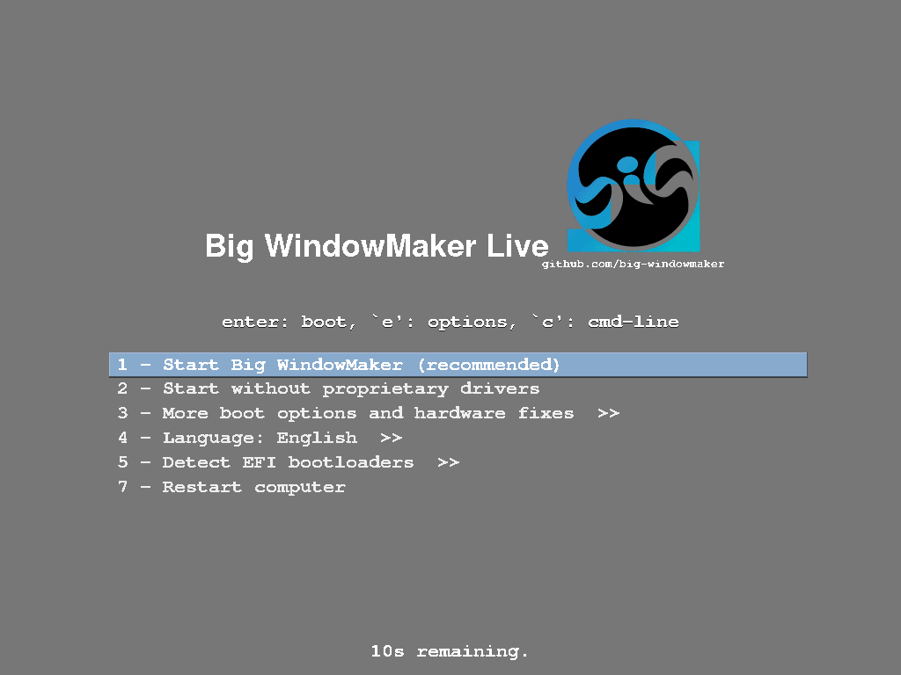 | 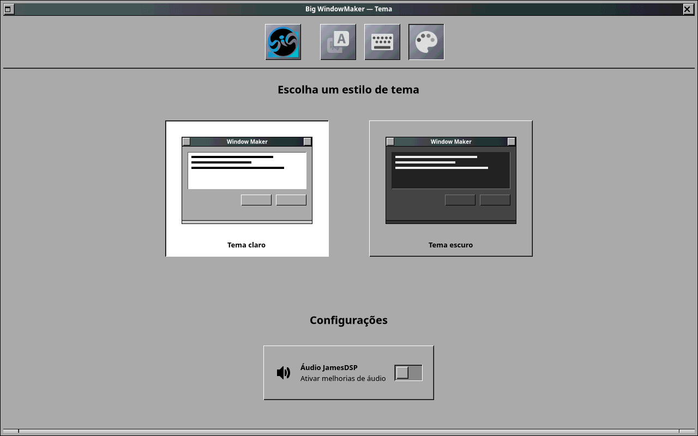 |
| Menu de boot da ISO | Assistente do live: idioma, teclado e tema |

No modo live o usuário é **`community`** e a senha é **`big`** (para o `sudo`).
Nada é gravado no disco até você instalar.

## 🧰 Instalar

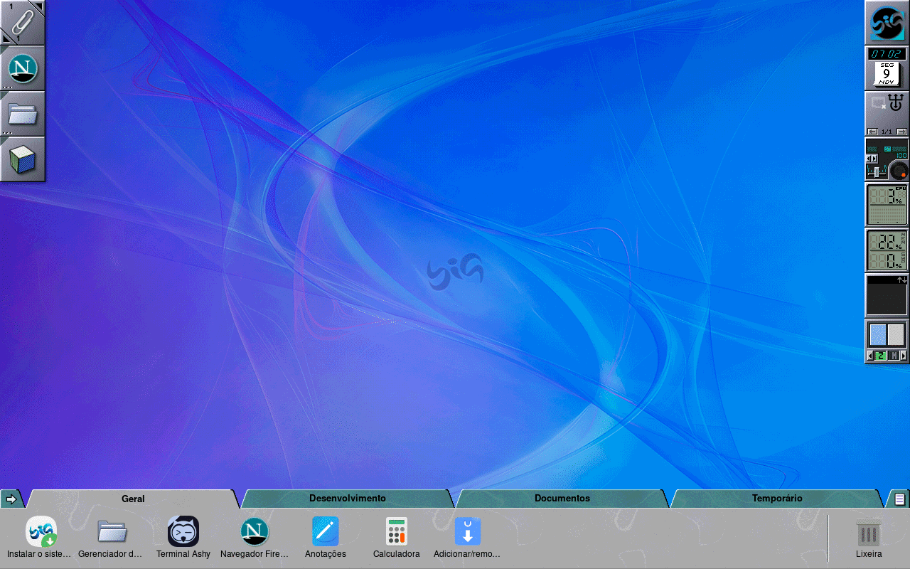

1. Na sessão live, clique em **Instalar o sistema** (primeiro ícone do Dock
   com abas, embaixo) e depois em **Instalar**.
2. O instalador (Calamares) segue estas etapas:

| Etapa | O que fazer |
|---|---|
| **Início** | Confira o idioma e clique em *Próximo*. |
| **Localização** | Região e fuso horário (o mapa já sugere pelo idioma). |
| **Teclado** | Para teclado brasileiro, *Portuguese (Brazil)* > *Padrão* (ABNT2). Teste digitando no campo de baixo. |
| **Partições** | **Apagar disco** usa o disco inteiro (Btrfs + partição EFI). Para manter outro sistema, use **Particionamento manual**. *Criptografar sistema* é opcional: a senha não pode ter acentos nem ç. |
| **Usuários** | Seu nome, usuário, nome do computador e senha. *Entrar automaticamente* é opcional. |
| **Resumo** | Revise: até aqui nada foi alterado. Clique em **Instalar**. |
| **Instalar** | Leva poucos minutos (cerca de 4 numa máquina virtual com SSD). |
| **Concluir** | Reinicie e retire o pendrive. |

<table>
<tr>
<td width="50%">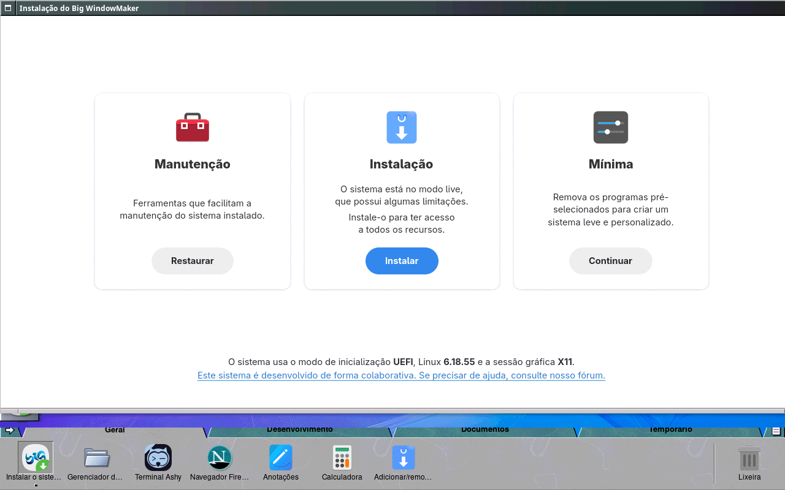<br>Antes do instalador: escolha <b>Instalação</b></td>
<td width="50%">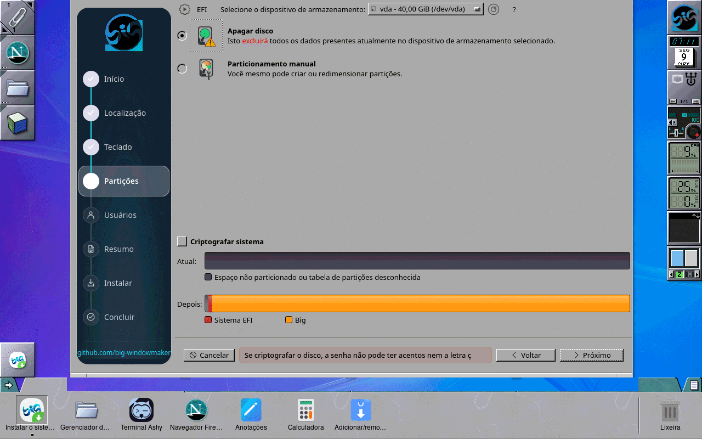<br><b>Partições</b>: Apagar disco ou manual</td>
</tr>
<tr>
<td>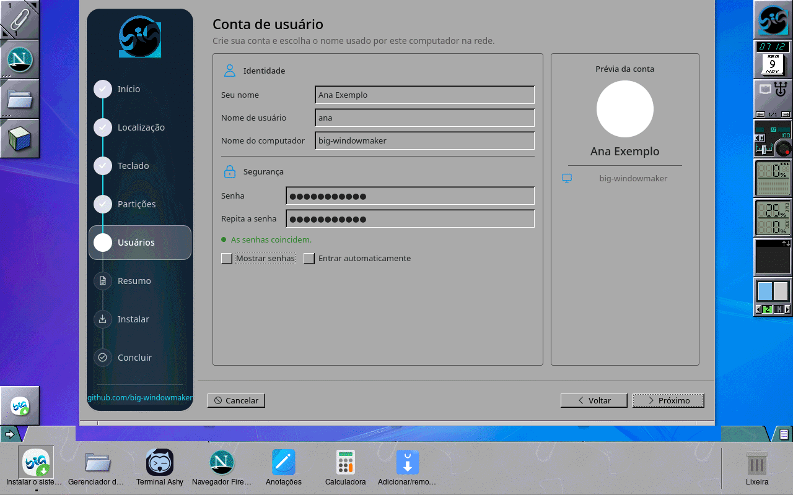<br><b>Usuários</b>: conta e senha</td>
<td>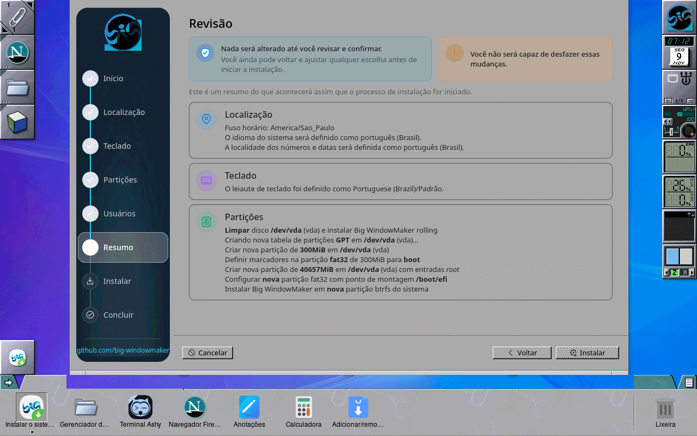<br><b>Resumo</b>: confira antes de instalar</td>
</tr>
</table>

## 👋 Primeiros passos

**Escolha a sessão na tela de login.** Selecione o usuário, abra a lista
**Sessão (F2)** e escolha **Big WindowMaker (X11)** (padrão, mais completo) ou
**Big WindowMaker (Wayland)** (experimental).

| | |
|---|---|
| 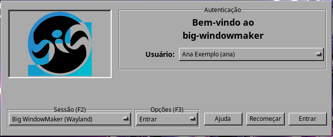 | 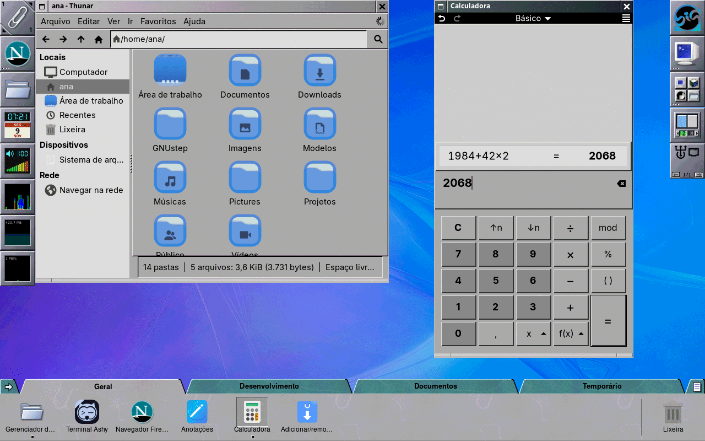 |
| Tela de login: escolha da sessão | Sistema instalado, sessão Wayland |

**O básico do Window Maker**

- **Clique direito na área de trabalho** (ou **F12**) abre o menu principal:
  Aplicativos, Aparência (tema, papel de parede, dockapps, organização de
  janelas), Configurações e Sessão.
- **Dock** (direita) e **Clip** (canto de cima à esquerda): clique duplo abre
  o programa; arraste o ícone de um aplicativo aberto para lá para fixá-lo.
- **Dock com abas** (embaixo): lançadores organizados em abas, como no
  OPENSTEP 4.0.
- **WPrefs** (*Configurações*, só no X11) ajusta foco, janelas, menus, teclado
  e mouse.

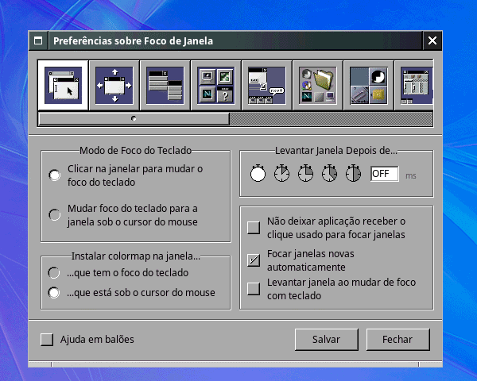

**Atalhos principais**

| Ação | Atalho |
|---|---|
| Menu principal | clique direito na área de trabalho / F12 |
| Buscar aplicativos | Super+Espaço |
| Terminal | Ctrl+Alt+T |
| Arquivos | Super+E |
| Histórico da área de transferência | Super+V |
| Bloquear a tela | Super+L |
| Captura de tela / de uma área | Print / Shift+Print |
| Alternar janelas | Alt+Tab |
| Fechar a janela | Alt+F4 |
| Mosaico automático liga/desliga | Super+Shift+Z |
| Mover a janela para a zona ao lado | Super+Ctrl+setas |

Lista completa no [README do big-wm](https://github.com/big-windowmaker/big-wm#atalhos-de-teclado).

## 🔄 Atualizar o sistema

O sistema-base (kernel, Firefox, LibreOffice, drivers...) vem dos repositórios
do BigLinux/BigCommunity e é atualizado normalmente, por **Adicionar/remover
programas** ou pelo terminal:

```sh
sudo pacman -Syu
```

> [!IMPORTANT]
> Na Alpha, os pacotes do **Big WindowMaker** (`big-wm-*`, `windowmaker`,
> `wlmaker`, `wmake-zones`, dockapps) ainda **não** estão num repositório
> público e não mudam com o `pacman -Syu`. Para recebê-los, instale uma ISO
> mais nova ou compile pelos repositórios
> [big-wm](https://github.com/big-windowmaker/big-wm#pacotes-num-sistema-biglinuxbigcommunity)
> e [packages](https://github.com/big-windowmaker/packages). O
> `/etc/pacman.conf` da edição segura o `windowmaker` (`IgnorePkg`) para que
> a versão do Big WindowMaker não seja trocada pela do Arch.

## 🧪 Testar numa máquina virtual

| Programa | Ajustes |
|---|---|
| **virt-manager** / **GNOME Boxes** (QEMU/KVM) | 4 GiB de RAM, 2 CPUs, disco de 40 GB, vídeo *Virtio*, firmware UEFI (OVMF) ou BIOS. É assim que cada ISO é testada antes de sair. |
| **VirtualBox** | Tipo *Linux / Arch Linux (64-bit)*, 4 GiB, 2 CPUs, vídeo **VMSVGA** com 128 MB; *Ativar EFI* é opcional. |

- A ISO já traz `spice-vdagent`, `qemu-guest-agent` e
  `virtualbox-guest-utils` (área de transferência e ajuste de resolução).
- A sessão **Wayland** funciona sem aceleração 3D (desenho por software, mais
  lento). No virt-manager, ligar *3D acceleration* (virgl) a deixa mais fluida.
- Na VM o Secure Boot também precisa estar desligado (no virt-manager, use o
  firmware `OVMF_CODE.4m.fd`, não o `secboot`).

## 🩺 Problemas comuns

<details>
<summary><b>O computador não inicia pelo pendrive</b></summary>

Desligue o **Secure Boot** no firmware. Confira se escolheu o pendrive no menu
de boot (com o prefixo UEFI, se houver). Se gravou com o Rufus, grave de novo
em **modo Imagem DD**. Confira o SHA-256 da ISO: um download corrompido dá
exatamente esse sintoma.
</details>

<details>
<summary><b>Tela preta depois do menu de boot</b></summary>

Tente **2 - Start without proprietary drivers** ou as opções de **3 - More
boot options and hardware fixes**. Com placas NVIDIA, prefira a sessão X11.
</details>

<details>
<summary><b>O 7-Zip diz que o arquivo está incompleto</b></summary>

Faltou uma das três partes, ou uma delas veio com tamanho errado. As três
precisam estar na mesma pasta, com os nomes originais. Rode a verificação do
`SHA256SUMS` e baixe de novo a que falhar.
</details>

<details>
<summary><b>A sessão Wayland não abre ou fica lenta</b></summary>

O Wayland é experimental nesta Alpha. Volte para **Big WindowMaker (X11)** na
lista **Sessão (F2)** da tela de login. Em máquina virtual, ligue a aceleração
3D ou use o X11. Limites conhecidos do wlmaker 0.8: sem métodos de entrada
(IME) e compartilhamento de tela só com GPU.
</details>

<details>
<summary><b>Qual a senha do modo live?</b></summary>

Usuário `community`, senha `big`.
</details>

<details>
<summary><b>Instalar ao lado do Windows</b></summary>

Faça backup antes. Reduza a partição do Windows pelo *Gerenciamento de
disco* do próprio Windows. No instalador, em **Partições**, escolha
**Particionamento manual**: crie a raiz (`/`) do Big WindowMaker no espaço
livre e use a partição EFI que já existe, montada em `/boot/efi`, **sem
formatar**.
</details>

Achou um erro? Abra uma issue no repositório da parte afetada (lista abaixo;
na dúvida, no [big-wm](https://github.com/big-windowmaker/big-wm/issues)) com
o modelo do computador, a sessão (X11 ou Wayland) e o que aconteceu.

## 🔜 Na próxima ISO

Prontos e testados, mas **ainda não na ISO que você baixa** hoje:

<table>
<tr>
<td width="50%">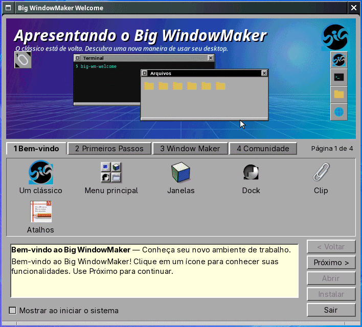<br><b>Boas-vindas</b>: o tutorial do primeiro login, no estilo dos anos 90</td>
<td width="50%">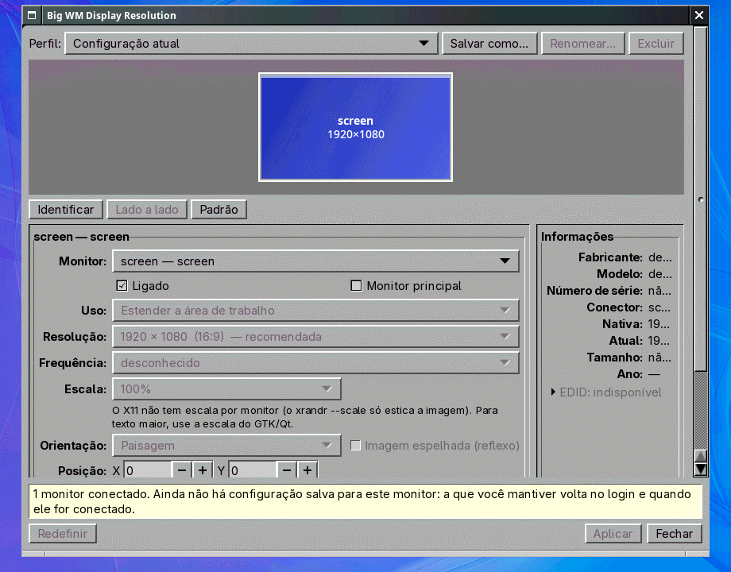<br><b>Display Resolution</b>: monitores, perfis e reversão automática</td>
</tr>
</table>

- Os dockapps do X11 no Wayland, iguais aos do X11, e ícones de aplicativos
  (appicons) no Wayland.
- Moldura do Window Maker em todas as janelas, inclusive Steam e Chrome.
- Lupa e zoom de acessibilidade (Ctrl+Alt+rolagem), localizar o ponteiro ao
  sacudir o mouse e Ctrl+Alt+Esc para fechar um programa travado.
- Menu Configurações reorganizado e tradução revisada.
- Instalador com a identidade visual do Big WindowMaker e o Sobre da edição.
- Menus de contexto e submenus no lugar no Wayland (o do GParted ia longe,
  embaixo à direita), invertendo perto da borda do monitor.
- Dock com Abas 0.3.0: o controlador redesenhado como painel OPENSTEP e a
  janela Sobre; wmake-zones 0.4.0 com mosaico para GTK4 e dockapp LCD.
- Monitores ligados e desligados com a sessão aberta (X11 e Wayland).

## 📦 Repositórios

| Repositório | Função | Estado |
|---|---|---|
| [big-wm](https://github.com/big-windowmaker/big-wm) | Sessões, configuração padrão, temas e integração do desktop | [](https://github.com/big-windowmaker/big-wm/actions/workflows/ci.yml) |
| [packages](https://github.com/big-windowmaker/packages) | PKGBUILDs: Window Maker, wlmaker, wmake-zones, dockapps | [](https://github.com/big-windowmaker/packages/actions/workflows/build.yml) |
| [big-wm-display-resolution](https://github.com/big-windowmaker/big-wm-display-resolution) | Monitores: resolução, disposição, perfis e reversão segura (X11 e Wayland) | [](https://github.com/big-windowmaker/big-wm-display-resolution/actions/workflows/ci.yml) |
| [tabbed-dock](https://github.com/big-windowmaker/tabbed-dock) | Dock horizontal com abas e o controlador no Dock (X11 e Wayland) | [](https://github.com/big-windowmaker/tabbed-dock/actions/workflows/ci.yml) |
| [wmake-zones](https://github.com/big-windowmaker/wmake-zones) | Zonas de encaixe e mosaico de janelas (X11 e Wayland) | [](https://github.com/big-windowmaker/wmake-zones/actions/workflows/ci.yml) |
| [build-iso](https://github.com/big-windowmaker/build-iso) | Geração da ISO, boot em VMs e teste de instalação (BIOS e UEFI) | [](https://github.com/big-windowmaker/build-iso/actions/workflows/build-iso.yml) |
| [iso-profiles](https://github.com/big-windowmaker/iso-profiles) | Perfil da edição `bigcommunity/wmaker` | |
| [biglinux-livecd](https://github.com/big-windowmaker/biglinux-livecd) | Sessão live e integração com o instalador | |
| [wmaker](https://github.com/big-windowmaker/wmaker) | Fork do [Window Maker](https://www.windowmaker.org/) para correções enviadas ao upstream | |
| [wlmaker](https://github.com/big-windowmaker/wlmaker) | Fork do [wlmaker](https://github.com/phkaeser/wlmaker) para correções enviadas ao upstream | |
| [.github](https://github.com/big-windowmaker/.github) | Este perfil, decisões de arquitetura e padrões | |

Documentação técnica:
[arquitetura (ADR-0001)](https://github.com/big-windowmaker/.github/blob/main/docs/adr/0001-arquitetura.md) ·
[auditoria e matriz de validação](https://github.com/big-windowmaker/.github/blob/main/docs/AUDITORIA.md) ·
[como a ISO é gerada e testada](https://github.com/big-windowmaker/build-iso#readme).

## 🤝 Contribuir

- **Bugs e ideias:** issues no repositório afetado (há modelos prontos).
- **Código:** leia o [guia de contribuição](https://github.com/big-windowmaker/.github/blob/main/CONTRIBUTING.md).
  Correções no Window Maker e no wlmaker também seguem para os projetos originais.
- **Segurança:** não abra issue pública; veja a
  [política de segurança](https://github.com/big-windowmaker/.github/blob/main/SECURITY.md)
  (relato privado pelo GitHub).

## Créditos e licença

**Mantenedores do Big WindowMaker**

- **Rafael Ruscher** — <rruscher@gmail.com>
- **Barnabé Di Kartola** — <barnabedikartola@gmail.com>

**Agradecimentos especiais**

- **Alfredo Kojima** — pelo desenvolvimento original do
  [Window Maker](https://www.windowmaker.org/) e pelo legado que inspirou
  este projeto.
- **Philipp Kaeser** — pelo [wlmaker](https://github.com/phkaeser/wlmaker) e
  pelo trabalho de levar a inspiração do Window Maker ao Wayland.
- **Bruno Gonçalves** — pelo [BigLinux](https://www.biglinux.com.br/) e por
  suas contribuições ao ecossistema Linux.
- **Tales A. Mendonça** — pelas contribuições ao desenvolvimento e
  fortalecimento da [BigCommunity](https://communitybig.org).

O Window Maker, o wlmaker e os demais projetos continuam com os seus
autores e mantenedores; o Big WindowMaker integra, empacota e corrige.

Software livre: cada repositório traz a sua licença (big-wm, wmake-zones e
tabbed-dock, big-wm-display-resolution e este perfil (.github): GPL-2.0-or-later; build-iso e biglinux-livecd: GPL-3.0;
PKGBUILDs do packages: 0BSD).

## In English

**Big WindowMaker** turns Window Maker into a complete desktop on
[BigLinux](https://www.biglinux.com.br) / [BigCommunity](https://communitybig.org),
with two sessions that share one look: **X11** with Window Maker (default,
stable) and **Wayland** with [wlmaker](https://github.com/phkaeser/wlmaker)
(experimental). It brings a Dock with classic dockapps, a tabbed dock,
snap zones and tiling, light and dark themes across GTK, libadwaita and Qt,
clipboard history and a monitor manager, all in the NeXTSTEP style. Try the
Alpha test ISO from [build-iso releases](https://github.com/big-windowmaker/build-iso/releases)
in live mode or a virtual machine first. Maintainers: Rafael Ruscher and
Barnabé Di Kartola. Special thanks to Alfredo Kojima (Window Maker),
Philipp Kaeser (wlmaker), Bruno Gonçalves (BigLinux) and Tales A. Mendonça
(BigCommunity).
