<p align="center">
  
</p>

<h1 align="center">Big WindowMaker</h1>

<p align="center">
  <b>O Window Maker como desktop completo, sobre o <a href="https://www.biglinux.com.br">BigLinux</a> / <a href="https://communitybig.org">BigCommunity</a>.</b><br>
  A elegância do NeXTSTEP, a integração de um sistema atual e duas sessões:<br>
  <b>X11</b> (Window Maker) e <b>Wayland</b> (wlmaker).
</p>

<p align="center">
  <a href="https://github.com/big-windowmaker/build-iso/releases"></a>
  
  
  
</p>

<p align="center">
  <a href="#-baixar-a-iso">Baixar</a> ·
  <a href="#-gravar-no-pendrive">Gravar</a> ·
  <a href="#-iniciar-pelo-pendrive">Iniciar</a> ·
  <a href="#-instalar-passo-a-passo">Instalar</a> ·
  <a href="#-primeiros-passos">Primeiros passos</a> ·
  <a href="#-problemas-comuns">Problemas comuns</a> ·
  <a href="#-informações-técnicas">Técnico</a> ·
  <a href="#-repositórios">Repositórios</a> ·
  <a href="#in-english">English</a>
</p>

<p align="center">
  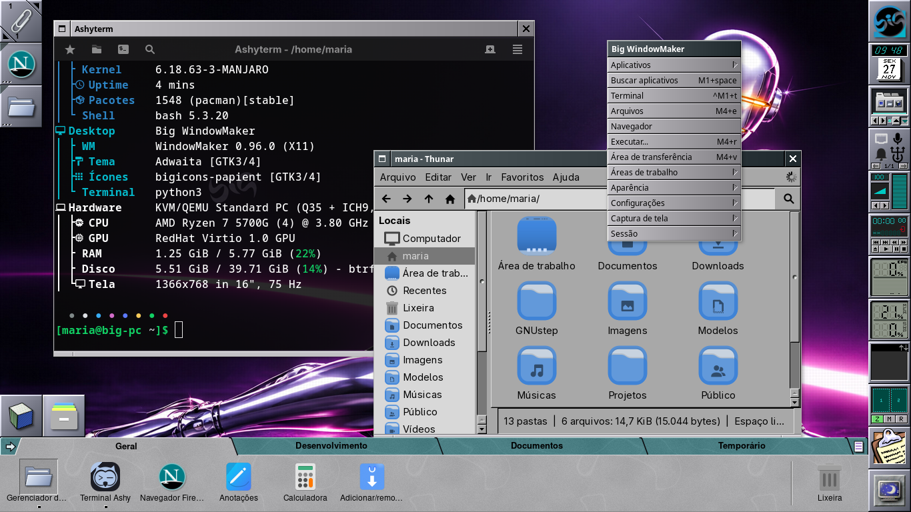
</p>

> [!IMPORTANT]
> **Beta 1 — a primeira versão para testes públicos.** O Big WindowMaker já
> serve para o dia a dia na sessão X11, e é isso que a Beta quer confirmar com
> mais pessoas e mais computadores. Instale num computador com **backup** (ou
> experimente antes no modo live ou numa máquina virtual) e conte o que
> encontrou pelo menu **Sessão > Relatar problema**. O sistema instalado recebe
> as correções pelo `pacman`, do repositório assinado
> [`[big-wm]`](https://github.com/big-windowmaker/repo).

## ✨ Destaques

| | |
|---|---|
| **Duas sessões, a mesma cara** | Window Maker no X11 (padrão, estável) e wlmaker no Wayland (experimental), com o mesmo tema, menus, papel de parede e atalhos. Você escolhe na tela de login. |
| **Dock, Clip e dockapps** | Dock com relógio, bandeja, volume, CPU, memória e rede; Clip com navegador e arquivos; cerca de 30 dockapps clássicos (wmcube, wmglobe, wmweather, wmmoonclock...) prontos em *Aparência > Dockapps*. |
| **Zonas e mosaico** | [wmake-zones](https://github.com/big-windowmaker/wmake-zones): zonas de encaixe ao arrastar (já vêm ligadas) e mosaico automático (Super+Shift+Z), também em vários monitores. |
| **Claro ou escuro** | *Aparência > Tema claro / Tema escuro* muda janelas, menus, Dock, GTK 2/3/4, libadwaita e Qt de uma vez. |
| **Tudo no estilo NeXTSTEP** | Barras de título do Window Maker em GTK, Qt, Firefox e VSCodium; ícones redesenhados; GRUB, Plymouth, tela de login e de bloqueio no mesmo estilo. |
| **Área de transferência** | **Super+V** abre o histórico, com busca, favoritos e privacidade, nas duas sessões. |
| **Dock com Abas** | Uma prateleira horizontal com abas, inspirada no OPENSTEP 4.0 beta, com os aplicativos abertos e os favoritos ([tabbed-dock](https://github.com/big-windowmaker/tabbed-dock)). |
| **Acessibilidade** | Leitor de tela Orca com **Super+Alt+S**; teclado na tela, digitação pelo controle e controle na tela ([big-keyboard](https://github.com/big-windowmaker/big-keyboard), em português e inglês); lupa com Ctrl+Alt+roda. |
| **Monitores** | *Configurações > Monitores*: resolução, disposição, perfis e volta automática em 15 s se algo der errado ([big-wm-display-resolution](https://github.com/big-windowmaker/big-wm-display-resolution)). |
| **Atualizações assinadas** | Os pacotes do Big WindowMaker vêm do repositório `[big-wm]`, assinado e conferido pelo `pacman`; um pacote adulterado é recusado. |
| **Leve** | A sessão X11 usa cerca de 300 MiB de memória (PSS), e o sistema todo cerca de 950 MiB, cinco minutos depois do login numa máquina de 4 GiB. |

<table>
<tr>
<td width="50%">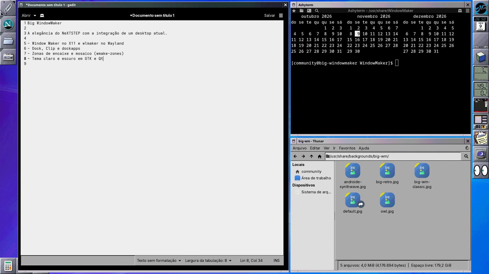<br><b>Mosaico automático</b> com o wmake-zones (X11)</td>
<td width="50%">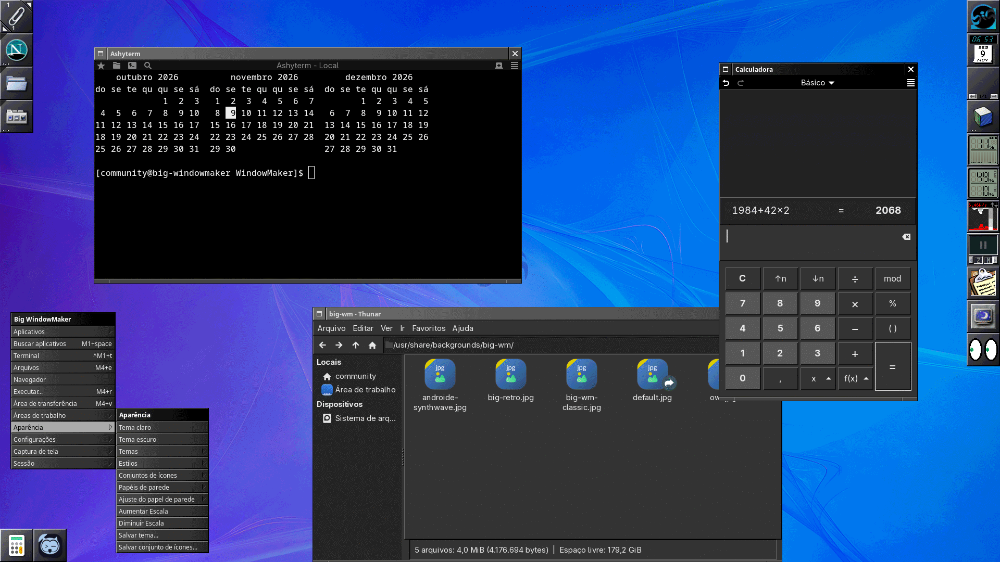<br><b>Tema escuro</b> em todos os toolkits (X11)</td>
</tr>
<tr>
<td>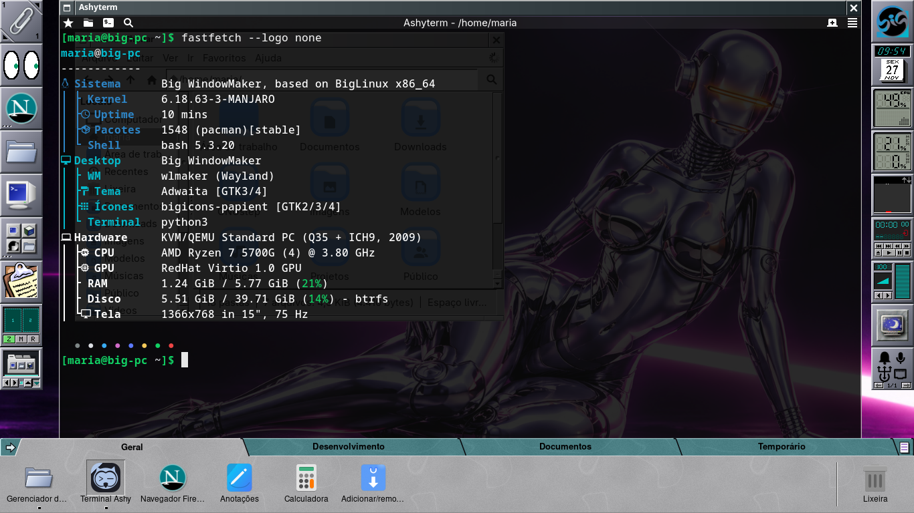<br><b>Sessão Wayland</b> com o wlmaker (Beta 1)</td>
<td>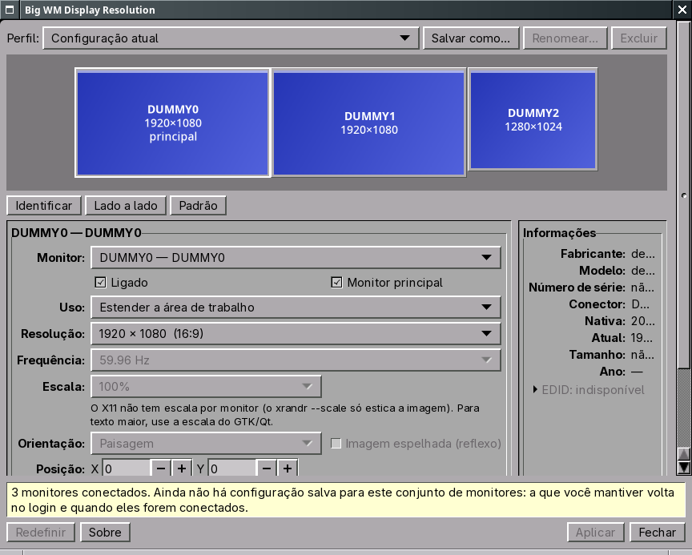 Monitores com três monitores desenhados em escala, resolução, frequência, orientação e informações do EDID"><br><b>Monitores</b>: várias telas, perfis e reversão segura</td>
</tr>
</table>

## 💻 Requisitos

| | Mínimo | Recomendado |
|---|---|---|
| Processador | x86_64 (64 bits) | 2 núcleos ou mais |
| Memória | 2 GiB | 4 GiB ou mais |
| Disco | 20 GB (o sistema recém-instalado ocupa cerca de 5 GiB) | 40 GB ou mais |
| Firmware | UEFI ou BIOS (Legacy) | UEFI |
| Pendrive | 8 GB | 8 GB ou mais, USB 3 |
| Vídeo | qualquer placa com driver no Linux | Intel, AMD ou NVIDIA com aceleração 3D (para o Wayland) |

> [!NOTE]
> **Desligue o Secure Boot.** A ISO traz o GRUB sem o *shim* assinado, então
> um firmware com Secure Boot ativo recusa o boot.

## 📥 Baixar a ISO

**Versão atual:** Big WindowMaker **Beta 1** (27/11/2026, kernel 6.18).

<p align="center">
  <a href="https://github.com/big-windowmaker/build-iso/releases/tag/big-windowmaker_BETA1_2026-11-27_k618-r74"></a>
</p>

A ISO tem 4,9 GiB (5,3 GB) e o GitHub limita cada arquivo a 2 GB, por isso ela vem em
**três partes `.7z`**. Baixe as três para a mesma pasta, junto com o
`SHA256SUMS`:

| Arquivo | Tamanho |
|---|---|
| [`big-windowmaker_BETA1_2026-11-27_k618-r74.iso.7z.001`](https://github.com/big-windowmaker/build-iso/releases/download/big-windowmaker_BETA1_2026-11-27_k618-r74/big-windowmaker_BETA1_2026-11-27_k618-r74.iso.7z.001) | 2,10 GB |
| [`big-windowmaker_BETA1_2026-11-27_k618-r74.iso.7z.002`](https://github.com/big-windowmaker/build-iso/releases/download/big-windowmaker_BETA1_2026-11-27_k618-r74/big-windowmaker_BETA1_2026-11-27_k618-r74.iso.7z.002) | 2,10 GB |
| [`big-windowmaker_BETA1_2026-11-27_k618-r74.iso.7z.003`](https://github.com/big-windowmaker/build-iso/releases/download/big-windowmaker_BETA1_2026-11-27_k618-r74/big-windowmaker_BETA1_2026-11-27_k618-r74.iso.7z.003) | 1,07 GB |
| [`SHA256SUMS`](https://github.com/big-windowmaker/build-iso/releases/download/big-windowmaker_BETA1_2026-11-27_k618-r74/SHA256SUMS) | somas de verificação |

> [!TIP]
> As ISOs saem como *pre-release*, e o atalho "latest" do GitHub ignora
> pre-releases. Para ver se há uma versão mais nova, abra a
> [**lista de releases**](https://github.com/big-windowmaker/build-iso/releases).

### Juntar as partes e conferir

O 7-Zip junta as partes; o SHA-256 prova que nada veio corrompido no
download. Não pule a conferência: um arquivo corrompido é a causa mais comum
de "o pendrive não dá boot".

<details open>
<summary><b>Linux</b></summary>

```sh
# Arch/Manjaro/BigLinux: sudo pacman -S 7zip   ·   Debian/Ubuntu: sudo apt install 7zip
sha256sum -c SHA256SUMS --ignore-missing          # confere as três partes
7z x big-windowmaker_BETA1_2026-11-27_k618-r74.iso.7z.001
sha256sum -c SHA256SUMS --ignore-missing          # agora confere também a .iso
```

Cada arquivo deve aparecer como `OK` (ou `SUCESSO`). Se algum falhar, baixe-o
de novo.

</details>

<details>
<summary><b>Windows</b></summary>

1. Instale o [7-Zip](https://www.7-zip.org/).
2. Clique com o botão direito em `...iso.7z.001` > **7-Zip > Extrair aqui**
   (ele junta as três partes sozinho).
3. Confira a ISO no PowerShell, na pasta dos arquivos:

   ```powershell
   Get-FileHash .\big-windowmaker_BETA1_2026-11-27_k618-r74.iso -Algorithm SHA256
   ```

4. O resultado precisa ser igual a:

   ```text
   E24C9AF6DBD640EA87B0C791B276ECF423DFA873FDFFD28F187EDA350D38F035
   ```

</details>

<details>
<summary><b>macOS</b></summary>

```sh
brew install sevenzip
shasum -a 256 -c SHA256SUMS --ignore-missing
7zz x big-windowmaker_BETA1_2026-11-27_k618-r74.iso.7z.001
shasum -a 256 big-windowmaker_BETA1_2026-11-27_k618-r74.iso
```

</details>

SHA-256 da ISO:
`e24c9af6dbd640ea87b0c791b276ecf423dfa873fdffd28f187eda350d38f035`

## 💾 Gravar no pendrive

> [!CAUTION]
> Gravar a ISO **apaga tudo** que está no pendrive.

| Ferramenta | Sistema | Como |
|---|---|---|
| [**balenaEtcher**](https://etcher.balena.io/) | Linux, Windows, macOS | *Flash from file* > a `.iso` > o pendrive > *Flash!* |
| [**Rufus**](https://rufus.ie/) | Windows | Escolha a `.iso` e *Iniciar*; quando ele perguntar, escolha **Gravar em modo Imagem DD** |
| [**Ventoy**](https://www.ventoy.net/) | Linux, Windows | Instale o Ventoy no pendrive uma vez e copie a `.iso` para ele (cabem várias ISOs) |
| `dd` | Linux | Veja abaixo |

<details>
<summary><b>Gravar com <code>dd</code> no Linux</b></summary>

Descubra o nome do pendrive **antes** de gravar: rode `lsblk` sem o pendrive,
conecte-o e rode de novo; o dispositivo novo (por exemplo `/dev/sdb`) é ele.
Use o disco inteiro (`/dev/sdb`), não uma partição (`/dev/sdb1`).

```sh
lsblk -o NAME,SIZE,MODEL,TRAN
sudo dd if=big-windowmaker_BETA1_2026-11-27_k618-r74.iso of=/dev/sdX bs=4M status=progress oflag=sync
```

> [!WARNING]
> Troque `/dev/sdX` pelo seu pendrive. O `dd` não pede confirmação: com o
> dispositivo errado ele apaga o seu disco.

</details>

## 🚀 Iniciar pelo pendrive

1. Com o pendrive conectado, ligue o computador e abra o **menu de boot**
   (geralmente F12, F11, F10, F8 ou Esc, conforme o fabricante).
2. Escolha o pendrive. Em computadores novos, prefira a entrada **UEFI**.
3. No menu da ISO, deixe **1 - Start Big WindowMaker (recommended)** (ele
   entra sozinho em alguns segundos). Se a tela ficar preta com placa NVIDIA,
   tente **2 - Start without proprietary drivers**; outras opções ficam em
   **3 - More boot options and hardware fixes**.
4. O modo live **entra direto**, sem tela de login, e um assistente faz três
   perguntas: **idioma**, **teclado** e **tema** (claro ou escuro). Clique na
   sua escolha em cada uma; a área de trabalho abre logo depois.

| | |
|---|---|
| 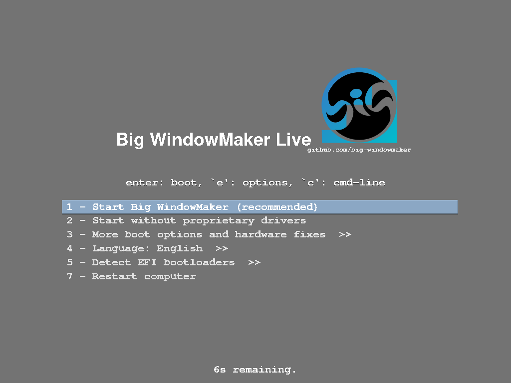 | 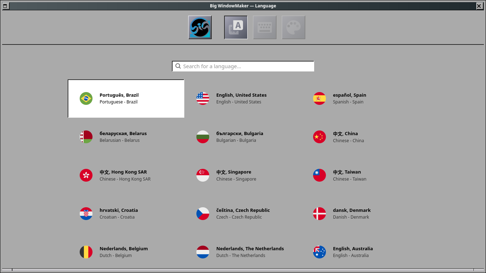 |
| **1.** Menu de boot da ISO | **2.** Assistente: idioma |
| 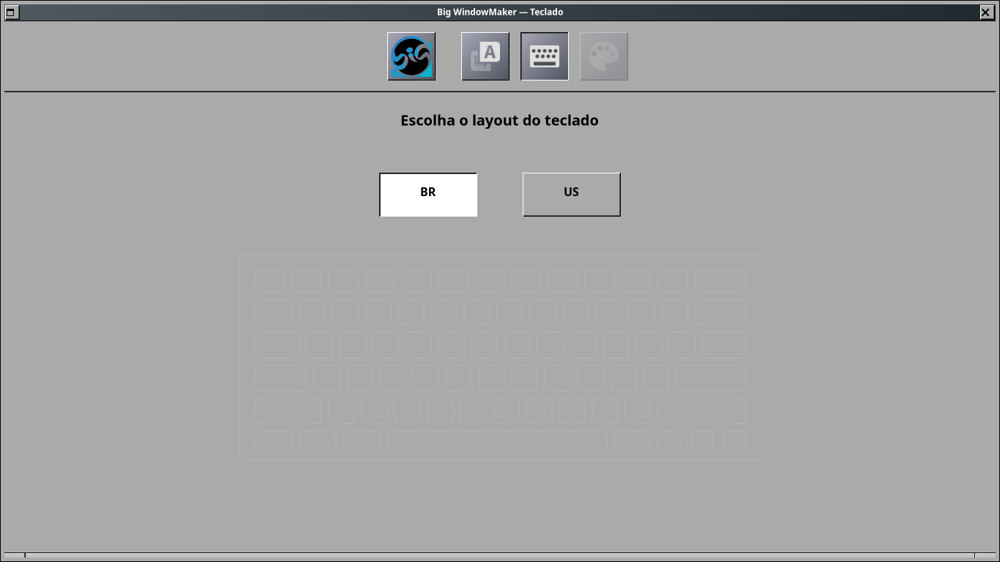 | 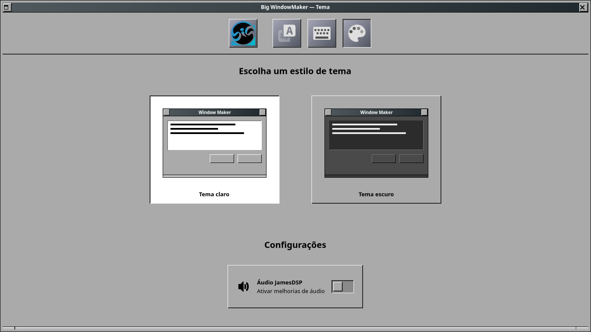 |
| **3.** Teclado: **BR** para o ABNT2 | **4.** Tema claro ou escuro |

<p align="center">
  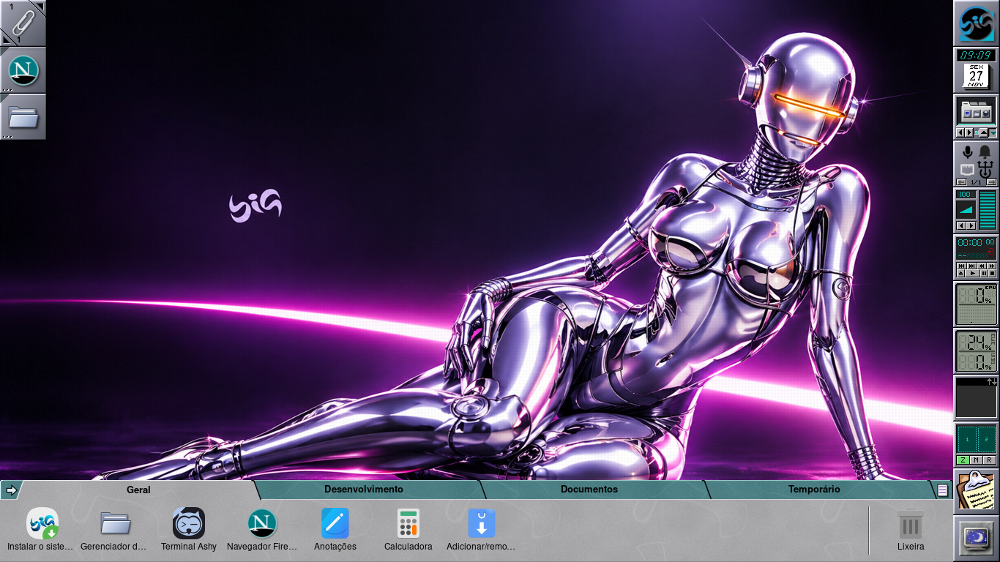<br>
  <b>5.</b> A sessão live, pronta para experimentar ou instalar
</p>

No modo live o usuário é **`bigwindowmaker`** e a senha é **`big`** (para o
`sudo`, e na tela de login se você encerrar a sessão). Nada é gravado no
disco até você instalar.

## 🧰 Instalar passo a passo

> [!CAUTION]
> **Faça backup antes.** A opção *Apagar disco* apaga o disco inteiro que você
> escolher. Para instalar ao lado do Windows ou de outro Linux, veja
> [*Instalar ao lado do Windows*](#-problemas-comuns).

A instalação leva de 5 a 15 minutos e **não precisa de internet**. Ligue o
notebook na tomada.

**1. Abra o instalador.** Na sessão live, clique em **Instalar o sistema**,
o primeiro ícone do Dock com Abas, embaixo. Num disco novo, sem partição
EFI, ele pergunta *"Deseja prosseguir com a instalação em modo EFI?"*: clique
em **Continuar**. Um clique basta: clicar de novo no mesmo ícone do Dock com
Abas minimiza a janela que acabou de abrir.

<p align="center">
  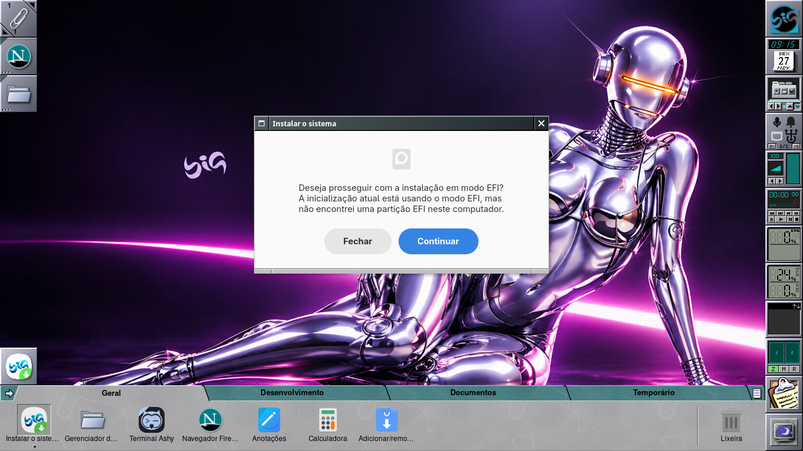
</p>

**2. Escolha "Instalação".** A tela seguinte tem três opções: *Manutenção*
(conserta um sistema já instalado), **Instalação** e *Mínima* (instala sem
alguns programas). Clique em **Instalar**. A tela *Dicas de instalação* explica
as escolhas automáticas (Btrfs, `/boot` dentro da raiz, swap em zram, sem
partição de swap): clique em **Continuar**.

| | |
|---|---|
| 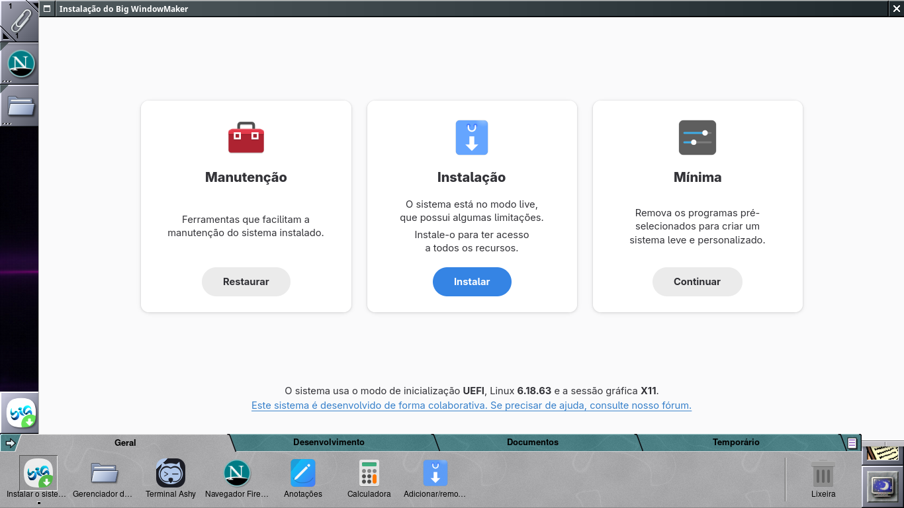 | 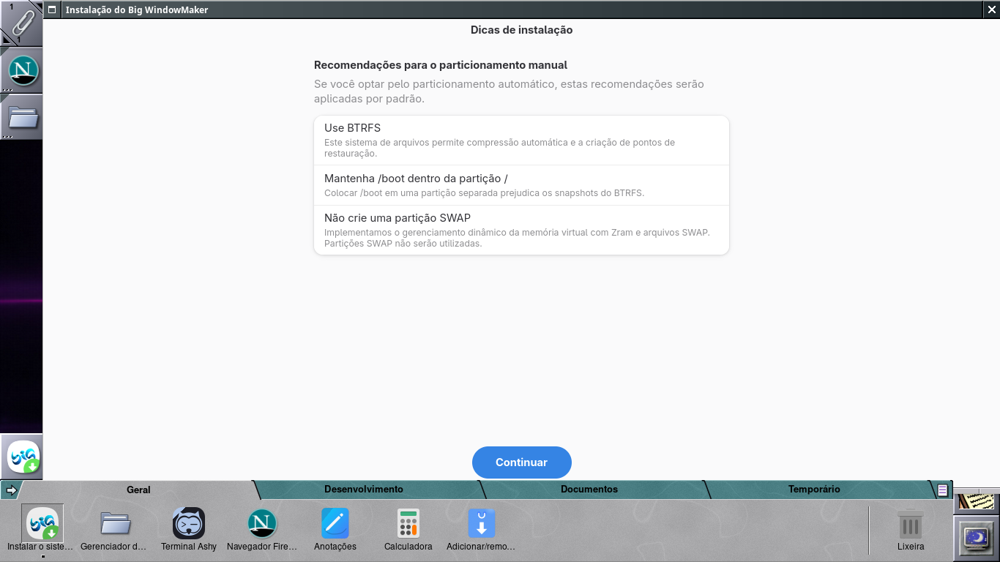 |
| Escolha **Instalação** | *Dicas de instalação*: **Continuar** |

**3. Siga o instalador (Calamares).** A lista à esquerda mostra onde você
está. Em cada etapa, confira e clique em **Próximo**, embaixo à direita:

| Etapa | O que fazer |
|---|---|
| **Início** | Confira o idioma. |
| **Localização** | Região e fuso horário. O mapa já sugere pelo idioma (Brasil: *America / Sao Paulo*). |
| **Teclado** | Para teclado brasileiro, *Portuguese (Brazil)* > *Padrão* (ABNT2). Teste digitando no campo de baixo (ç, acentos). |
| **Partições** | **Apagar disco** usa o disco inteiro (Btrfs e, em UEFI, uma partição EFI). Confira o disco no alto: o nome e o tamanho precisam ser os do disco certo. *Particionamento manual* é para manter outro sistema. *Criptografar sistema* é opcional: a senha não pode ter acentos nem ç. |
| **Usuários** | Seu nome; o instalador sugere o nome de usuário (minúsculas, sem espaço) e o do computador, que você pode trocar; a senha duas vezes. *Entrar automaticamente* pula a tela de login. |
| **Resumo** | A página *Revisão* mostra tudo o que vai acontecer: **até aqui nada foi alterado**. Clicar em **Instalar** começa a gravar no disco. |
| **Instalar** | A barra mostra o andamento. Enquanto isso, dá para jogar o **NeuroDefender**, um arcade retrô no próprio instalador. |
| **Concluir** | *Instalação concluída*: clique em **Reiniciar o sistema** e retire o pendrive quando a tela apagar. |

<table>
<tr>
<td width="50%">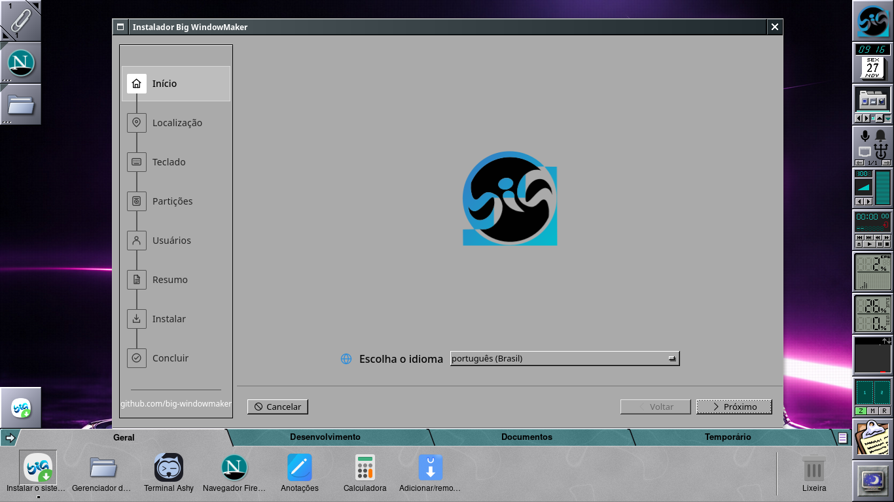<br><b>Início</b>: o idioma</td>
<td width="50%">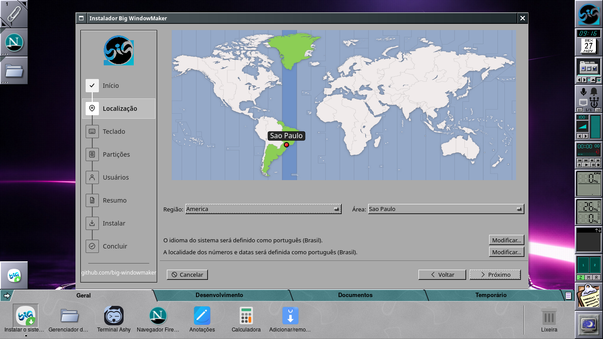<br><b>Localização</b>: fuso horário</td>
</tr>
<tr>
<td>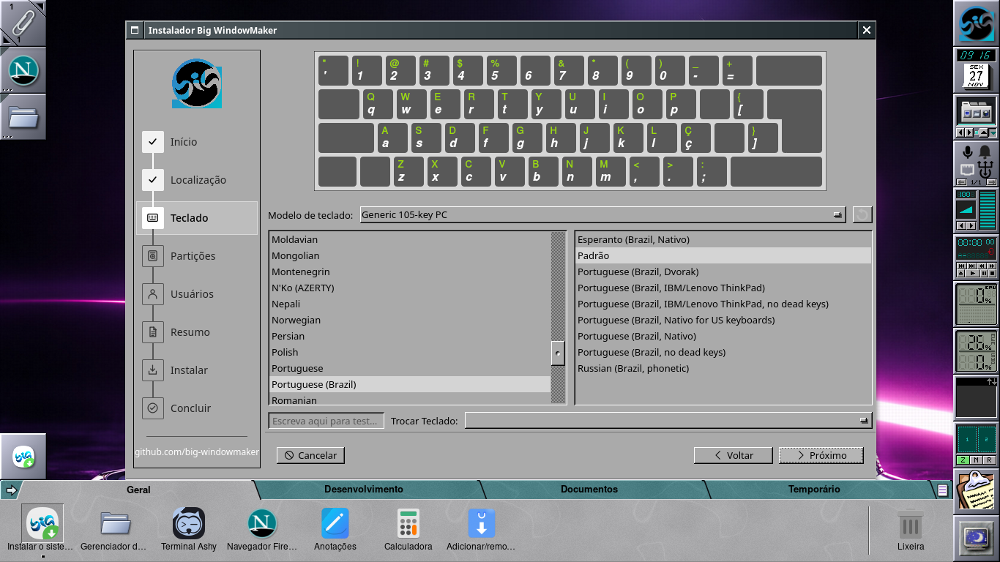<br><b>Teclado</b>: layout e teste</td>
<td>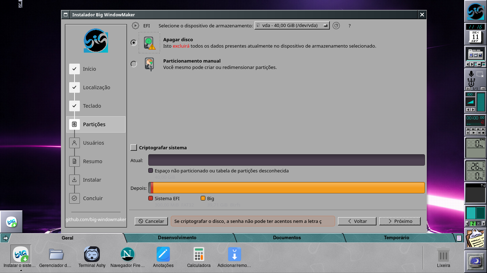<br><b>Partições</b>: Apagar disco ou manual</td>
</tr>
<tr>
<td>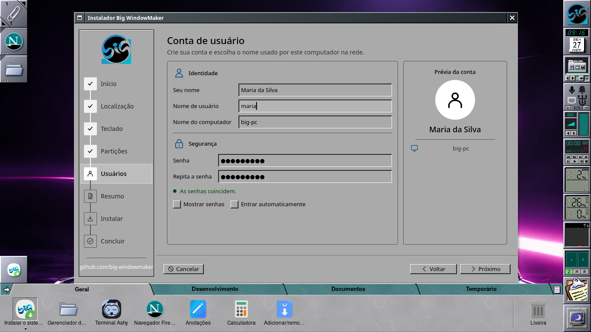<br><b>Usuários</b>: conta e senha</td>
<td>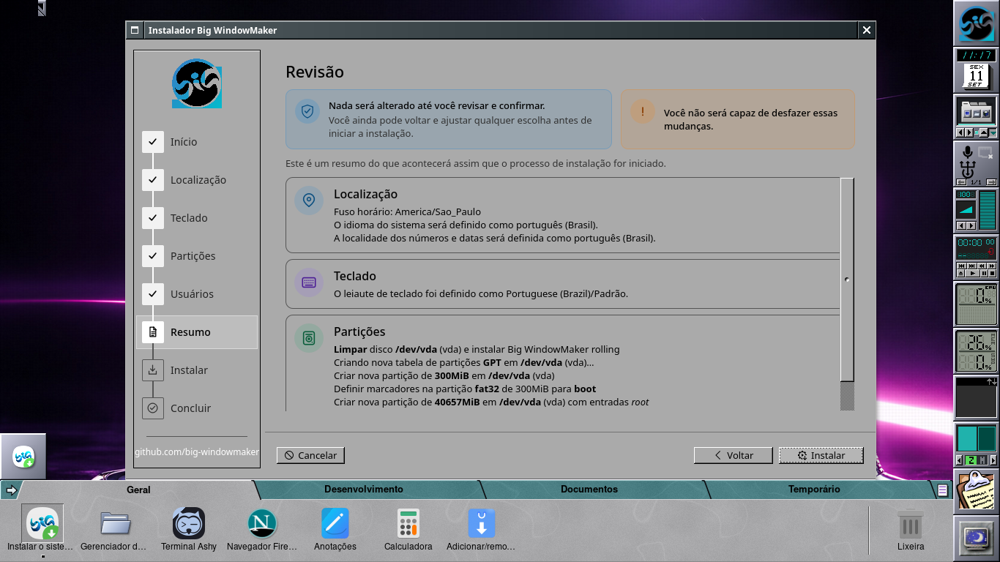<br><b>Resumo</b>: confira antes de instalar</td>
</tr>
<tr>
<td>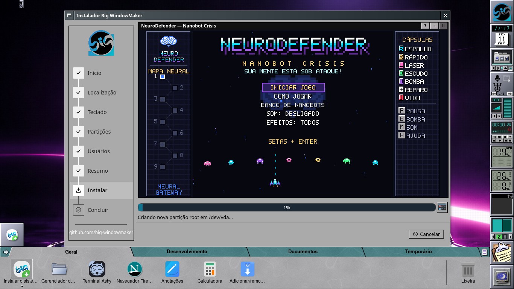<br><b>Instalar</b>: o NeuroDefender enquanto copia</td>
<td>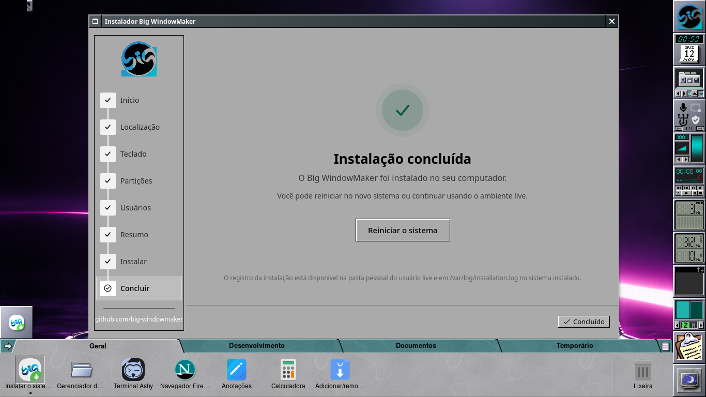<br><b>Concluir</b>: reinicie no sistema novo</td>
</tr>
</table>

> [!NOTE]
> **Sem internet também funciona.** O instalador avisa que não há conexão,
> mas a internet não é obrigatória. Se o relógio do computador estiver
> atrasado (bateria da placa-mãe fraca, por exemplo), ele é adiantado até a
> data das chaves dos pacotes antes da instalação; a hora se acerta sozinha
> quando o computador conectar à internet. O registro da instalação fica em
> `/var/log/installation.log`.

**4. Primeiro login.** Depois de reiniciar, a tela de login (wdm) já mostra o
seu usuário: tecle **Enter**, digite a senha e tecle **Enter** de novo. A
sessão padrão é a **X11**; para trocar, veja abaixo. No primeiro login abre a
janela de **Boas-vindas**, um tour pelo Menu, Dock, Clip e atalhos.

## 👋 Primeiros passos

**Escolha a sessão na tela de login (wdm).** A tecla **F2** alterna o campo
**Sessão** entre **Big WindowMaker (X11)** (padrão, mais completo) e **Big
WindowMaker (Wayland)** (experimental); depois entre normalmente. A escolha
fica guardada para o próximo login.

| | |
|---|---|
| 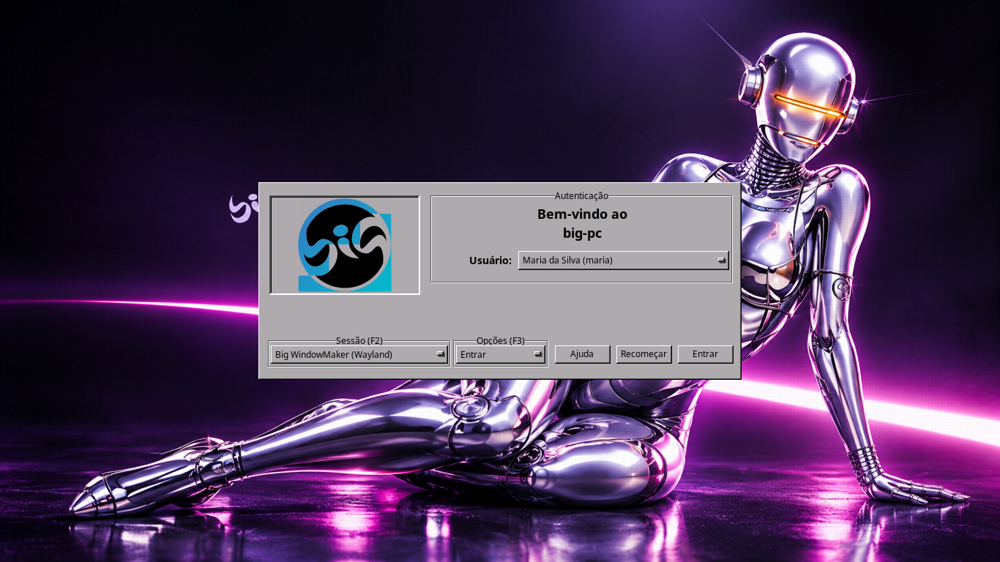 | 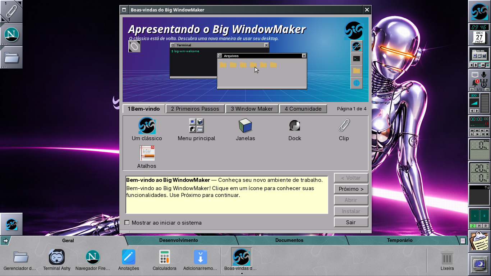 |
| Login (wdm): F2 alterna X11 e Wayland | Primeiro login (X11), com as Boas-vindas |
| 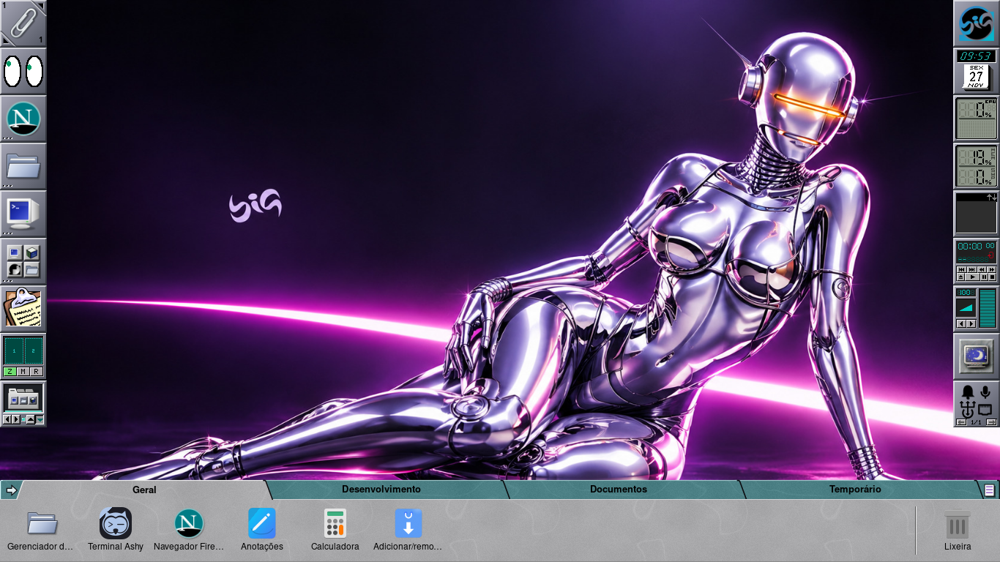 | 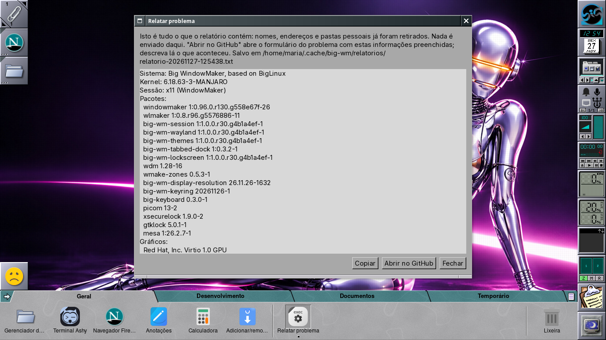 |
| Primeiro login, sessão Wayland | **Sessão > Relatar problema** |

**O básico do Window Maker**

- **Clique direito na área de trabalho** (ou **F12**) abre o menu principal:
  Aplicativos, Aparência (tema, papel de parede, dockapps, organização de
  janelas), Configurações e Sessão.
- **Dock** (direita) e **Clip** (canto de cima, à esquerda): clique duplo
  abre o programa; arraste o ícone de um aplicativo aberto para lá para
  fixá-lo.
- **Dock com Abas** (embaixo): lançadores e janelas abertas em abas, como no
  OPENSTEP 4.0.
- **WPrefs** (*Configurações*, só no X11) ajusta foco, janelas, menus, teclado
  e mouse.
- O [**guia do usuário**](https://github.com/big-windowmaker/big-wm/blob/main/docs/guia-do-usuario.md)
  explica Dock, Clip, zonas, aparência, bloqueio e atualizações.

**Atalhos principais**

| Ação | Atalho |
|---|---|
| Menu principal | clique direito na área de trabalho / F12 |
| Buscar aplicativos | Alt+Espaço (no Wayland também Super+Espaço) |
| Terminal | Ctrl+Alt+T |
| Arquivos | Super+E |
| Histórico da área de transferência | Super+V |
| Bloquear a tela | Super+L |
| Captura: tela / janela / área | Print / Alt+Print / Shift+Print |
| Alternar janelas | Alt+Tab |
| Fechar a janela | Alt+F4 |
| Leitor de tela (Orca) liga/desliga | Super+Alt+S |
| Ampliar a tela | Ctrl+Alt+roda do mouse |
| Escolher a zona pelo teclado | Super+Z |
| Mosaico automático liga/desliga | Super+Shift+Z |
| Mover a janela para a zona ao lado | Super+Ctrl+setas |

Lista completa no [README do big-wm](https://github.com/big-windowmaker/big-wm#atalhos-de-teclado).

## 🔄 Atualizar o sistema

O sistema-base (kernel, Firefox, LibreOffice, drivers...) vem dos repositórios
do BigLinux/BigCommunity, e os pacotes do Big WindowMaker (`big-wm-*`,
`windowmaker`, `wlmaker`, `wmake-zones`, dockapps) vêm do repositório assinado
[`[big-wm]`](https://github.com/big-windowmaker/repo), que já vem configurado.
Tudo é atualizado junto, por **Adicionar/remover programas** ou pelo terminal:

```sh
sudo pacman -Syu
```

Se uma atualização do Big WindowMaker trouxer um problema, o README do
repositório explica
[como voltar à versão anterior](https://github.com/big-windowmaker/repo#voltar-atrás-um-pacote-com-problema).

> [!IMPORTANT]
> **Instalou de uma ISO anterior à de 26/11?** Ela não tem o `[big-wm]` e
> segura o `windowmaker` com `IgnorePkg`. Ative o repositório uma vez, com os
> passos do [README do repositório](https://github.com/big-windowmaker/repo#ativar);
> depois disso, o `pacman -Syu` traz as correções.

## 🐞 Relatar um problema

O jeito mais fácil é o menu **Sessão > Relatar problema**: ele monta um
relatório com as versões, a placa de vídeo, os monitores e os erros recentes,
**sem nome de usuário, nome do computador, pastas, IPs ou e-mails**, mostra o
texto inteiro para você conferir e abre o formulário da issue já preenchido no
GitHub. Nada é enviado sem você. Você também pode abrir uma issue direto no
repositório da parte afetada (lista em [Repositórios](#-repositórios); na
dúvida, no [big-wm](https://github.com/big-windowmaker/big-wm/issues)) com o
modelo do computador, a sessão (X11 ou Wayland) e o que aconteceu.

## 🧪 Testar numa máquina virtual

| Programa | Ajustes |
|---|---|
| **virt-manager** / **GNOME Boxes** (QEMU/KVM) | 4 GiB de RAM, 2 CPUs, disco de 40 GB, vídeo *Virtio*, firmware UEFI (OVMF) ou BIOS. É assim que cada ISO é testada antes de sair. |
| **VirtualBox** | Tipo *Linux / Arch Linux (64-bit)*, 4 GiB, 2 CPUs, vídeo **VMSVGA** com 128 MB; *Ativar EFI* é opcional. |

- A ISO já traz `spice-vdagent`, `qemu-guest-agent` e
  `virtualbox-guest-utils` (área de transferência e ajuste de resolução).
- A sessão **Wayland** funciona sem aceleração 3D (desenho por software, mais
  lento). No virt-manager, ligar *3D acceleration* (virgl) a deixa mais fluida.
- Na VM o Secure Boot também precisa estar desligado (no virt-manager, use o
  firmware `OVMF_CODE.4m.fd`, não o `secboot`).

## 🩺 Problemas comuns

<details>
<summary><b>O computador não inicia pelo pendrive</b></summary>

Desligue o **Secure Boot** no firmware. Confira se escolheu o pendrive no menu
de boot (com o prefixo UEFI, se houver). Se gravou com o Rufus, grave de novo
em **modo Imagem DD**. Confira o SHA-256 da ISO: um download corrompido dá
exatamente esse sintoma.
</details>

<details>
<summary><b>Tela preta depois do menu de boot</b></summary>

Tente **2 - Start without proprietary drivers** ou as opções de **3 - More
boot options and hardware fixes**. Com placas NVIDIA, prefira a sessão X11.
</details>

<details>
<summary><b>O 7-Zip diz que o arquivo está incompleto</b></summary>

Faltou uma das três partes, ou uma delas veio com tamanho errado. As três
precisam estar na mesma pasta, com os nomes originais. Rode a verificação do
`SHA256SUMS` e baixe de novo a que falhar.
</details>

<details>
<summary><b>A sessão Wayland não abre ou fica lenta</b></summary>

O Wayland é experimental nesta Beta. Volte para **Big WindowMaker (X11)** na
lista **Sessão (F2)** da tela de login. Em máquina virtual, ligue a aceleração
3D ou use o X11. Limites conhecidos do wlmaker 0.8: sem métodos de entrada
(IME), compartilhamento de tela só com GPU e o Orca sem os comandos da tecla
Orca.
</details>

<details>
<summary><b>Qual a senha do modo live?</b></summary>

Usuário `bigwindowmaker`, senha `big`. O live entra sem pedir; a senha serve
para o `sudo` e para entrar de novo se você encerrar a sessão.
</details>

<details>
<summary><b>Instalar ao lado do Windows</b></summary>

Faça backup antes. Reduza a partição do Windows pelo *Gerenciamento de
disco* do próprio Windows. No instalador, em **Partições**, escolha
**Particionamento manual**: crie a raiz (`/`) do Big WindowMaker no espaço
livre (Btrfs) e use a partição EFI que já existe, montada em `/boot/efi`,
**sem formatar**. O menu do GRUB passa a oferecer os dois sistemas.
</details>

<details>
<summary><b>Firewall</b></summary>

O firewall (`ufw`) vem **ligado** no sistema instalado e só aceita conexões
de fora para o compartilhamento de arquivos (Samba), a descoberta de
impressoras e compartilhamentos (mDNS) e o SSH, que só responde se você ligar
o `sshd`. Para liberar outro programa, ou desligar o firewall:

```sh
sudo ufw allow 8080/tcp   # exemplo: libera uma porta
sudo ufw status           # mostra as regras
sudo ufw disable          # desliga (sudo ufw enable liga de novo)
```

Instalado de uma ISO anterior a 24/11? Lá o firewall vem desligado e
`sudo ufw enable` falha com `UnicodeEncodeError` (um acento no comentário do
`/etc/ufw/ufw.conf`). Apague o comentário e ligue:

```sh
sudo sed -i '/^# Big WindowMaker/,/^ENABLED/{/^#/d}' /etc/ufw/ufw.conf
sudo ufw allow SSH        # se acessar este computador por SSH
sudo ufw enable
```

</details>

<details>
<summary><b>Computador com Intel antiga (G45, GM45, Q45) travando</b></summary>

A ISO já usa o driver `intel` nessas placas, sem *page flip*, porque o driver
padrão travava a GPU ("GPU HANG" no `journalctl -k`). Se ainda travar na
sessão Wayland, acrescente `WLR_RENDERER=pixman` ao `/etc/environment` e
reinicie.
</details>

## 🆕 Novidades da Beta 1

Desde a Alpha de 26/11:

- **Drivers proprietários na instalação:** o instalador passa a instalar os
  drivers da placa de vídeo (NVIDIA), de Wi-Fi (Broadcom) e de máquina virtual
  com o `big-driver-manager-cli`, do repositório offline da ISO. Antes, esse
  passo falhava em silêncio e o sistema instalado ficava só com os drivers
  livres.
- **Relatar problema** voltou a abrir (o menu não mostrava nada).
- **Espelhos só por HTTPS**, também nos que o instalador e o pamac escolhem.
- **Leitor de tela:** **Super+Alt+S** liga e desliga o Orca nas duas sessões
  (também em *Configurações*). Ele lê os aplicativos (GTK, Qt, Firefox,
  terminal); no Wayland, os comandos da tecla Orca ainda não funcionam.
- **Teclado na tela em inglês e português** (big-keyboard 0.3.0), e as
  boas-vindas usam o mesmo teclado nas duas sessões.
- **Abertura da sessão mais robusta:** cada etapa tem limite de tempo, então
  um programa travado no login não segura mais a área de trabalho; um
  programa que falta no início automático do Wayland não derruba a sessão.
- **Thunar** com duas correções de travamento do upstream (diálogo de
  propriedades).
- **Repositório `[big-wm]`:** assinatura feita num ambiente protegido e
  [como voltar atrás](https://github.com/big-windowmaker/repo#voltar-atrás-um-pacote-com-problema)
  com um pacote que deu problema.
- **Testes:** cada build da ISO abre as sessões X11 e Wayland pelos lançadores
  de verdade, instala pelo Calamares em BIOS e UEFI e atualiza o sistema
  instalado pelo `[big-wm]`.

<details>
<summary><b>Histórico das Alphas (06/11 a 26/11)</b></summary>

- **26/11:** repositório assinado `[big-wm]` configurado no sistema
  instalado; *Sessão > Relatar problema*; travamentos registrados
  (`coredumpctl`); tela de bloqueio do X11 sem piscar; guia do usuário; versão
  semântica (`1:1.0.0`).
- **24/11:** tela de bloqueio com a cara do wdm nas duas sessões; Dock e Clip
  organizados e Clip em grade no Wayland; microfone da bandeja e captura de
  tela reescritos em C (mais leves); chaveiro do GNOME; firewall ligado (Samba,
  mDNS e SSH); sem dnsmasq; espelhos em HTTPS; Intel G45/Q45 sem *page flip*.
- **21/11:** área de transferência nova (Super+V) com histórico e favoritos;
  central de notificações; Sair, Reiniciar e Desligar com confirmação no
  Wayland; jogos em tela cheia sem tela preta; Dock com Abas 0.3.2.
- **17/11:** mais leve em computadores antigos; *Configurações > Efeitos
  visuais*; relógio certo (NTP); modo live direto na sessão; resolução do GRUB
  ajustada ao monitor.
- **15/11:** teclado virtual com controle na tela e o celular como controle;
  boas-vindas e lupa; Steam e jogos no monitor certo no Wayland.
- **14/11:** tela de login wdm; instalação sem internet mesmo com o relógio
  atrasado; o NeuroDefender no instalador; Window Maker 26; Thunar 4.21.
- **06/11 e 12/11:** primeiras ISOs de teste.

</details>

## 🔧 Informações técnicas

| | |
|---|---|
| **Base** | [BigCommunity](https://communitybig.org) (edição `bigcommunity/wmaker`), sobre o BigLinux e o Manjaro; pacotes do ramo *testing* da BigCommunity/BigLinux. Kernel 6.18 LTS. |
| **Sessão X11** | [Window Maker](https://www.windowmaker.org/) 0.96.0 (git `558e67f` + 32 patches), compositor `picom` opcional (*Configurações > Efeitos visuais*). |
| **Sessão Wayland** | [wlmaker](https://github.com/phkaeser/wlmaker) 0.8 (git `5576886` + 179 patches; os que servem a todos são enviados ao autor) e XWayland para programas X11. |
| **Login e bloqueio** | wdm (Window Maker Display Manager); bloqueio pelo `xsecurelock` no X11 e `gtklock` no Wayland, com a mesma aparência. |
| **Componentes próprios** | big-wm 1.0.0 (sessões, temas, menus, integração), wmake-zones 0.5.3, Dock com Abas 0.3.2, big-keyboard 0.3.0, big-wm-display-resolution, cerca de 30 dockapps. |
| **Drivers** | `big-driver-manager-cli` (do BigLinux): na live e na instalação, conforme a opção do boot (`driver=nonfree` na entrada recomendada, `driver=free` na 2). |
| **Disco** | Btrfs com subvolumes `@` e `@home` (pontos de restauração), `/boot` dentro da raiz, memória virtual em zram e arquivo de swap (sem partição de swap). |
| **Segurança** | Firewall `ufw` ligado; repositório `[big-wm]` assinado com a chave `2F36 D64F 633B BA80 052F 4893 4AF5 FC29 61C2 E4AF` (pacote `big-wm-keyring`); `SigLevel = Required`. |
| **Memória** (ISO de 26/11, 5 min depois do login, VM de 4 GiB) | Sessão X11: ~295 MiB (PSS); Wayland: ~340 MiB; sistema todo: ~950 MiB em uso. |
| **Testes de cada ISO** | Boot em QEMU (BIOS e UEFI) até a sessão live; instalação pelo Calamares com o openQA (BIOS e UEFI); login no sistema instalado; atualização pelo `[big-wm]` com a assinatura conferida. |

Documentação técnica:
[arquitetura (ADR-0001)](https://github.com/big-windowmaker/.github/blob/main/docs/adr/0001-arquitetura.md) ·
[plano e estado do projeto](https://github.com/big-windowmaker/.github/blob/main/docs/PLANEJAMENTO-ESTRATEGICO.md) ·
[como a ISO é gerada e testada](https://github.com/big-windowmaker/build-iso#readme) ·
[documentação do big-wm](https://github.com/big-windowmaker/big-wm/blob/main/docs/README.md).

## 📦 Repositórios

| Repositório | Função | Estado |
|---|---|---|
| [big-wm](https://github.com/big-windowmaker/big-wm) | Sessões, configuração padrão, temas e integração do desktop | [](https://github.com/big-windowmaker/big-wm/actions/workflows/ci.yml) |
| [packages](https://github.com/big-windowmaker/packages) | PKGBUILDs: Window Maker, wlmaker, wmake-zones, dockapps | [](https://github.com/big-windowmaker/packages/actions/workflows/build.yml) |
| [big-wm-display-resolution](https://github.com/big-windowmaker/big-wm-display-resolution) | Monitores: resolução, disposição, perfis e reversão segura (X11 e Wayland) | [](https://github.com/big-windowmaker/big-wm-display-resolution/actions/workflows/ci.yml) |
| [big-keyboard](https://github.com/big-windowmaker/big-keyboard) | Teclado virtual, digitação pelo controle e controle na tela (X11 e Wayland) | [](https://github.com/big-windowmaker/big-keyboard/actions/workflows/ci.yml) |
| [big-trust-alt](https://github.com/big-windowmaker/big-trust-alt) | Abrir programas do Windows com segurança: análise do arquivo e alternativas para Linux | |
| [tabbed-dock](https://github.com/big-windowmaker/tabbed-dock) | Dock horizontal com abas e o controlador no Dock (X11 e Wayland) | [](https://github.com/big-windowmaker/tabbed-dock/actions/workflows/ci.yml) |
| [wmake-zones](https://github.com/big-windowmaker/wmake-zones) | Zonas de encaixe e mosaico de janelas (X11 e Wayland) | [](https://github.com/big-windowmaker/wmake-zones/actions/workflows/ci.yml) |
| [repo](https://github.com/big-windowmaker/repo) | Repositório pacman assinado `[big-wm]` | [](https://github.com/big-windowmaker/repo/actions/workflows/publicar.yml) |
| [build-iso](https://github.com/big-windowmaker/build-iso) | Geração da ISO, boot em VMs e teste de instalação (BIOS e UEFI) | [](https://github.com/big-windowmaker/build-iso/actions/workflows/build-iso.yml) |
| [iso-profiles](https://github.com/big-windowmaker/iso-profiles) | Perfil da edição `bigcommunity/wmaker` | |
| [biglinux-livecd](https://github.com/big-windowmaker/biglinux-livecd) | Sessão live e integração com o instalador | |
| [wmaker](https://github.com/big-windowmaker/wmaker) | Fork do [Window Maker](https://www.windowmaker.org/) para correções enviadas ao upstream | |
| [wlmaker](https://github.com/big-windowmaker/wlmaker) | Fork do [wlmaker](https://github.com/phkaeser/wlmaker) para correções enviadas ao upstream | |
| [.github](https://github.com/big-windowmaker/.github) | Este perfil, decisões de arquitetura e planejamento | |

## 🤝 Contribuir

- **Testar a Beta** é a contribuição que mais ajuda agora: instale, use por
  alguns dias e relate o que encontrar (*Sessão > Relatar problema*).
- **Código:** leia o [guia de contribuição](https://github.com/big-windowmaker/.github/blob/main/CONTRIBUTING.md).
  Correções no Window Maker e no wlmaker também seguem para os projetos originais.
- **Segurança:** não abra issue pública; veja a
  [política de segurança](https://github.com/big-windowmaker/.github/blob/main/SECURITY.md)
  (relato privado pelo GitHub).

## Créditos e licença

**Mantenedores do Big WindowMaker**

- **Rafael Ruscher** — <rruscher@gmail.com>
- **Barnabé Di Kartola** — <barnabedikartola@gmail.com>

**Agradecimentos especiais**

- **Alfredo Kojima** — pelo desenvolvimento original do
  [Window Maker](https://www.windowmaker.org/) e pelo legado que inspirou
  este projeto.
- **Philipp Kaeser** — pelo [wlmaker](https://github.com/phkaeser/wlmaker) e
  pelo trabalho de levar a inspiração do Window Maker ao Wayland.
- **Bruno Gonçalves** — pelo [BigLinux](https://www.biglinux.com.br/) e por
  suas contribuições ao ecossistema Linux.
- **Tales A. Mendonça** — pelas contribuições ao desenvolvimento e
  fortalecimento da [BigCommunity](https://communitybig.org).

O Window Maker, o wlmaker e os demais projetos continuam com os seus
autores e mantenedores; o Big WindowMaker integra, empacota e corrige.

Software livre: cada repositório traz a sua licença (big-wm, wmake-zones e
tabbed-dock, big-wm-display-resolution e este perfil (.github): GPL-2.0-or-later; build-iso e biglinux-livecd: GPL-3.0;
PKGBUILDs do packages: 0BSD).

## In English

**Big WindowMaker** turns Window Maker into a complete desktop on
[BigLinux](https://www.biglinux.com.br) / [BigCommunity](https://communitybig.org),
with two sessions that share one look: **X11** with Window Maker (default,
stable) and **Wayland** with [wlmaker](https://github.com/phkaeser/wlmaker)
(experimental). It brings a Dock with classic dockapps, a tabbed dock,
snap zones and tiling, light and dark themes across GTK, libadwaita and Qt,
clipboard history, the Orca screen reader (Super+Alt+S), an on-screen
keyboard and gamepad in English and Portuguese, and a monitor manager, all in
the NeXTSTEP style. **Beta 1** is the first build for public testing: download
it from the [build-iso releases](https://github.com/big-windowmaker/build-iso/releases)
(three `.7z` parts plus `SHA256SUMS`, see [Baixar a ISO](#-baixar-a-iso)),
try it live or in a virtual machine, and install it with the Calamares
installer (UEFI or BIOS, Secure Boot off). Installed systems get updates
through the signed [`[big-wm]`](https://github.com/big-windowmaker/repo)
pacman repository; report problems from the *Session* menu (*Relatar problema*).
Maintainers: Rafael Ruscher and Barnabé Di Kartola. Special thanks to Alfredo
Kojima (Window Maker), Philipp Kaeser (wlmaker), Bruno Gonçalves (BigLinux)
and Tales A. Mendonça (BigCommunity).
